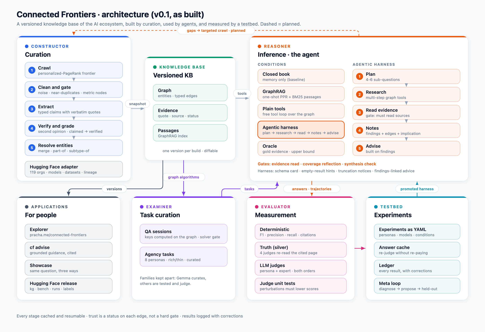
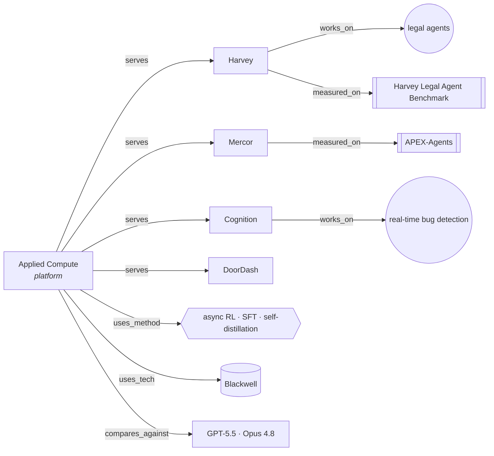
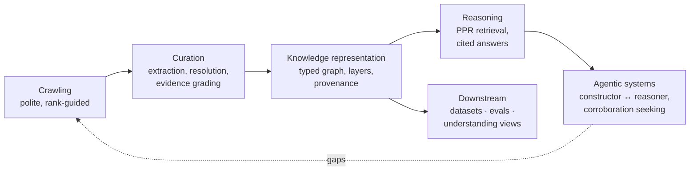

# Connected Frontiers

> A knowledge graph of the frontier-AI research and industry ecosystem: who serves whom, on which
> problems, with which methods, measured on which benchmarks, on what infra, and hiring for which
> skills. It is **built the PageRank way** by a rank-guided crawler, every claim keeps its quote and
> an evidence status, and **agents reason over it** to help people decide what to learn, build and test.

**▶ Explore it:** [pracha.me/connected-frontiers](https://pracha.me/connected-frontiers/) (click an entity to explore its connections and evidence).

What started as a curiosity is now an end-to-end system: curation and indexing of a knowledge graph,
a harness for inference agents, task curation, and evaluation testbeds, used to test whether grounding
in the graph actually helps people.

**Status (2026-11-22):** v0.1. The crawl round is built into KB `v20261122-0022`. The agent harness was
improved by a measured loop (held-out confirmed); the agency testbed (persona tasks, persona and expert
LLM judges) is running its pilot. Everything below is measured, with intervals, and limits are stated.

| v0.1 at a glance | |
|---|---|
| Graph (KB `v20261122-0022`) | 1,921 pages · 254 publishers · **15,544 entities · 17,930 edges** · 22,035 quoted claims · 133 segments · Hugging Face lineage for 169 mapped orgs (partly attached; see backlog) |
| Truth (silver judges re-read the cited page) | verifier-accepted edges supported 93–97% · rejected ones 50% (the verifier is too strict) · ER accuracy 0.86 |
| Grounded QA (10 sessions, KB `v20261121-1821`) | Inkling-2-small: graph tools **0.86** F1 vs **0.19** from memory (paired Δ +0.67 [+0.56, +0.76]) |
| Harness improvement (14 held-out sessions) | schema card + longer neighbour lists: graph tools 0.71 → **0.94** F1, graph query 0.57 → **0.98** (Inkling); every interval above 0 |
| Cost | **$8.9** of LLM spend in total, small open-weight models |



*Architecture as built ([SVG](docs/architecture.svg)); dashed parts are planned.*

---

## Why

The ecosystem changes weekly, and the connections that explain it are spread across company pages,
case studies, research blogs, papers, leaderboards and job posts. One page already holds a lot.
Applied Compute's `/training` page alone gives about 25 typed edges:



*(These are claims from the page, stored as `claimed` until corroborated.)*

Following these links recursively, ranked so that **things reached by several paths rise**, is
how the graph grows.

## What it's for

Think **Connected Papers, but for the whole ecosystem**: not just papers citing papers, but labs,
neolabs, startups, infra, customers, problems, methods, benchmarks, models, roles and skills, with
every link backed by graded evidence.

| Who | Use |
|---|---|
| Researchers and engineers | see who works on a problem, with which methods, measured how; find gaps; pick projects |
| Newcomers and professionals | build a mental model of the stack, layer by layer; see which skills the frontier hires for |
| Agents | a grounded, cited knowledge source to reason over (the Reasoner), instead of model memory |
| Dataset and eval builders | curated, provenance-carrying data; a 5-task benchmark ([docs/DATASET.md](docs/DATASET.md)) |

It is also a **practice ground for the whole chain**, with each stage measured:



## How it works

| Part | What it does | Where |
|---|---|---|
| 🕸️ **Constructor** (curation) | rank-guided crawl → noise gates → extract → verify → grade → resolve → versioned KB (graph + GraphRAG index); Hugging Face adapter for models, datasets and lineage | `src/cf/crawl`, `extract`, `graph`, `resolve`, `adapters`, `docs.py`, `kb.py` |
| 🧠 **Reasoner** (inference) | five conditions: closed book · GraphRAG · plain tools · **agentic harness** (plan → research → read evidence → notes → advice built on findings, with three gates) · oracle | `src/cf/agent`, `src/cf/bench/guidance.py` |
| 🧪 **Examiner** (task curation) | QA sessions whose answers are computed on the graph (solver-gated), and **agency tasks** for 8 personas, curated and written by a separate model family | `src/cf/bench/sessions.py`, `agency.py` |
| 📏 **Evaluator** | deterministic scores · silver truth checks · **persona and expert LLM judges** · judge unit tests (deliberately degraded answers must score lower) | `src/cf/eval`, `src/cf/bench/agency.py` |
| 🔬 **Testbed** | experiments as YAML, answer cache, ledger with corrections, meta loop (diagnose → propose → held-out → promote) | `configs/experiments`, `src/cf/bench/meta.py` |
| 🗺️ **Applications** | public explorer · `cf advise` (grounded guidance with cited findings) · showcase · HF release | `src/cf/viz`, `agency.py`, `release.py` |

The gap between the Examiner (which knows each answer) and the Reasoner (which must find it), per
retrieval mode and turn, is each release's scorecard. Design: [docs/DESIGN.md](docs/DESIGN.md) and, for
the persona evaluation, [docs/AGENCY_EVAL.md](docs/AGENCY_EVAL.md).

The core experiment: does **personalized-PageRank "push" crawling** reach the relevant
ecosystem in fewer fetches than **BFS**? Details are in [docs/DESIGN.md §3](docs/DESIGN.md#3-the-crawl-algorithm-and-estimating-coverage).

## Initial evaluation (v0.1)

**How it is measured.** The Examiner computes each turn's answer from the KB with graph algorithms,
an LLM only phrases the questions, deterministic checks reject leaks and empty keys, and a solver
gate (two model families, given the gold evidence) proves every turn is answerable. The Reasoner then
answers the same sessions in each retrieval mode. Scores are per turn (set F1, or exact status
labels), aggregated per session; intervals are 95% session-bootstrap; mode differences are paired
tests on the same sessions. Truth is checked separately (silver judges re-read the cited pages),
because KB-derived keys measure use of the KB, not whether the KB is right.

**Results on 10 sessions × 4 models × 5 modes** (mean turn F1; whole-session pass@1 in brackets):

| Model | Closed book | GraphRAG | KG tools | Graph query | Oracle |
|---|---|---|---|---|---|
| Inkling-2-small | 0.19 (0%) | 0.26 (0%) | **0.86 (40%)** | 0.51 (0%) | 0.90 (60%) |
| Qwen3.5-35B-A3B | 0.05 (0%) | 0.20 (0%) | 0.67 (20%) | 0.45 (0%) | 0.77 (40%) |
| Mistral-Small-2603 | 0.07 (0%) | 0.16 (0%) | 0.49 (10%) | 0.44 (0%) | 0.63 (40%) |
| Nemotron-3.5-lightning | 0.06 (0%) | 0.13 (0%) | 0.37 (0%) | 0.22 (0%) | 0.54 (0%) |

**What it says, and how sure we are**

- **The KB is what makes these answers possible.** No model gets a whole session right closed book;
  with KG tools Inkling reaches 0.86, near its 0.90 with perfect evidence (oracle). The KG-tools vs
  closed-book gain is significant for every model (paired Δ F1 from +0.31 to +0.67, all intervals above 0).
- **One-shot GraphRAG barely helps** (+0.07 for Inkling, interval crosses 0). Its PageRank retrieval
  ignores relation types, and these sessions are typed and multi-hop.
- **Model-written graph queries trail the step-by-step walk** (0.51 vs 0.86, paired Δ +0.34
  [+0.07, +0.63]). Unexplored: the query tool's interface may be what fails, not the idea.
- **Nemotron-lightning's ceiling is low** (0.54 even with the oracle): it measures the model, not the KB.
- **Uncertainty is large.** 10 sessions give pass@1 intervals ~60 points wide. Next run: 40 sessions,
  3 trials each (pass^3 for reliability), precision / recall / citation validity, an owner audit of 20 keys.

**First run, untuned harness:** default prompts and tool descriptions, no retries, no self-verification.
Bugs fixed while building it (all with tests): answers listing the question's subject instead of the
answer (now schema-enforced), a prompt that suppressed tool use, lineage keys asking for data the source
never recorded, and JSONL records split by Unicode line separators. The harness was then improved, as
measured below.

### Improving the harness, measured (v0.1)

The first numbers above came from an untuned harness. A meta loop read the failures on a training split
(66% of graph queries returned nothing; lists were silently cut at 25 edges), a different-family model
proposed three harness changes, and the best was confirmed on 14 held-out sessions:

| Model · mode | Old harness | Schema card + neighbour lists of 50 | Whole session right |
|---|---|---|---|
| Inkling-2-small · graph tools | 0.71 | **0.94** | 36% → 64% |
| Inkling-2-small · graph query | 0.57 | **0.98** | 21% → 71% |
| Qwen3.5-35B · graph tools | 0.58 | **0.87** | 14% → 50% |
| Qwen3.5-35B · graph query | 0.37 | **0.87** | 7% → 43% |

The gain is mostly recall: telling the agent which relations exist stops it missing entities. One
held-out run was invalidated when the API key ran out mid-run; the ledger keeps that correction.

### Beyond QA: guidance for people (in progress)

The next question is whether the graph helps people decide what to learn, build and test. Eight persona
profiles (undergraduate to senior research engineer, career switcher, forward-deployed engineer) get
tasks curated from the graph; answers from memory, plain tools and the agentic harness are judged by
persona and expert LLM judges, after the judges pass unit tests. Design and hypotheses:
[docs/AGENCY_EVAL.md](docs/AGENCY_EVAL.md). On one capstone question, the agentic harness built its advice
from 8 cited findings and surfaced 13 organisations that no answer from memory named; whether that holds
across tasks is what the testbed measures.

## Quickstart

Requires Python ≥ 3.11 and [uv](https://docs.astral.sh/uv/).

```bash
make setup          # creates .venv, installs deps, creates .env from .env.example
# edit .env  → OPENROUTER_API_KEY=...   (HF_TOKEN optional if `hf auth login` was done)
make doctor         # checks keys (presence only), configs, folders
make test           # runs the test suite
uv run cf --help    # crawl · rank · ask · viz · eval · release
```

Optional extras: `uv sync --extra extract-baseline` (GLiNER, pulls torch), `--extra resolve`,
`--extra data`, `--extra release`, `--extra js` (Playwright).

## Commands

| Command | Does | Milestone |
|---|---|---|
| `cf doctor` | environment and config check | ✅ |
| `cf scout --pages 6 --hop2-orgs 25` | multi-seed crawl → extract → verify → explorer | ✅ |
| `cf build` | rebuild graph from cache + HF adapter + ER + segments + report | ✅ |
| `cf silver --version v1` | ensemble silver labels; owner dispute queue | ✅ |
| `cf tasks` / `cf bench` | use-case tasks from the KG; agent benchmark + leaderboard | ✅ |
| `cf sessions` / `cf sessions-bench` | Examiner: build + gate multi-turn sessions; Reasoner runs them in every retrieval mode, per-turn scores | ✅ |
| `cf silver-kb` | does the status ladder mean anything? edges stratified by status, judged on their cited page; verifier + ER vs silver | ✅ |
| `cf eval` | per-KB scorecard → `reports/scorecard-<kb>.md` | ✅ |
| `cf crawl --budget N [--resume\|--status]` | PPR frontier crawl, noise gates, checkpoints (`scripts/crawl_supervisor.sh` keeps it alive) | ✅ |
| `cf serve` | local dashboard: crawl monitor at `/`, explorer at `/explorer` | ✅ |
| `cf lookup "<name or url>"` / `cf cache` | answer from KG or fetch live · cache freshness and refresh cost | ✅ |
| `cf docs` / `cf ask "<q>" --mode graph_rag` | GraphRAG document index · grounded answers citing passages + edges | ✅ |
| `cf kb list\|show\|diff\|use` | versioned KB snapshots (manifest: counts, models, prompts, git) | ✅ |
| `cf release [--push --repo …]` | HF collection: kg · bench (tasks + sessions) · runs · labels (push is private, explicit) | ✅ |
| `cf advise "<question>" --persona <key>` | grounded guidance: the agentic harness researches the KB, cites its findings, writes a markdown card | ✅ |
| `cf experiment configs/experiments/<name>.yaml` | agency experiment: curated tasks → answers (cached) → judge unit tests → persona and expert judges → report | ✅ |
| `cf meta [--confirm h2 --confirm h3]` | meta loop: diagnose failures → propose harness specs → select on train → confirm on held-out | ✅ |
| `cf discover` · `cf guidance` | persona discovery and guidance evals (earlier versions of the agency testbed) | ✅ |
| `cf site` · `scripts/deploy_pages.sh` | build and deploy the public explorer to GitHub Pages | ✅ |
| `cf crawl --policy bfs` vs `ppr` | the core crawl comparison | built, comparison run pending |

## Project layout

```
connected-frontiers/
├── README.md · PROBLEM.md · EVAL.md · DECISIONS.md
├── pyproject.toml · Makefile · .env.example
├── docs/       DESIGN.md · AGENCY_EVAL.md · DATASET.md · architecture.svg/.png · case-study/
├── configs/    seeds.yaml · crawl.yaml · models.yaml · personas.yaml · experiments/
├── src/cf/     cli · crawl/ extract/ resolve/ graph/ rank/ adapters/ agent/ bench/ eval/ viz/ llm/ · kb · docs · release · serve
├── tests/      notebooks/
├── data/       raw/ interim/ processed/ (gitignored) · samples/
├── scripts/    crawl supervisor · deploy · diagram, poster and showcase generators
└── eval/       gold/ (frozen) · experiments/ · experiments.jsonl (ledger) · results/ (gitignored)
```

## Documents

| Doc | Read it for |
|---|---|
| [PROBLEM.md](PROBLEM.md) | north star, user, task, objective: the eight objects |
| [docs/DESIGN.md](docs/DESIGN.md) | **layered architecture** (acquire → extract/verify → curate → represent → use → evaluate → release), crawl algorithm, understanding views |
| [docs/AGENCY_EVAL.md](docs/AGENCY_EVAL.md) | persona-based evaluation of guidance: task curation, judges, judge validation, hypotheses |
| [docs/DISCOVERY.md](docs/DISCOVERY.md) | opportunity discovery and education uses (owner priorities) |
| [EVAL.md](EVAL.md) | metrics, frozen test sets, baselines, results log |
| [docs/EVIDENCE.md](docs/EVIDENCE.md) | truth vs claim: evidence grading, Reasoner wording rules |
| [docs/DATASET.md](docs/DATASET.md) | Hugging Face dataset and benchmark plan |
| [DECISIONS.md](DECISIONS.md) | dated decisions and open questions |

## Principles

- **Algorithms decide, models judge.** Crawl policy and stopping rules are algorithms, so they
  can be compared. Models handle reading and judgment, and each has a non-LLM baseline.
- **Claim ≠ fact.** Every edge is graded by its citations: who says it (self, counterparty,
  independent record, press), how many independent publishers back it, and whether the quote
  really supports it. The ladder runs unsupported → claimed → confirmed → corroborated → verified,
  with contested and stale flags. Answers must word claims as claims. See
  [docs/EVIDENCE.md](docs/EVIDENCE.md).
- **Measured, not asserted.** Coverage is estimated, improvements show learning curves, and
  failures are logged.
- **Polite crawling.** Respect robots.txt, rate-limit requests, cache raw pages, no logins, and no
  personal data.
