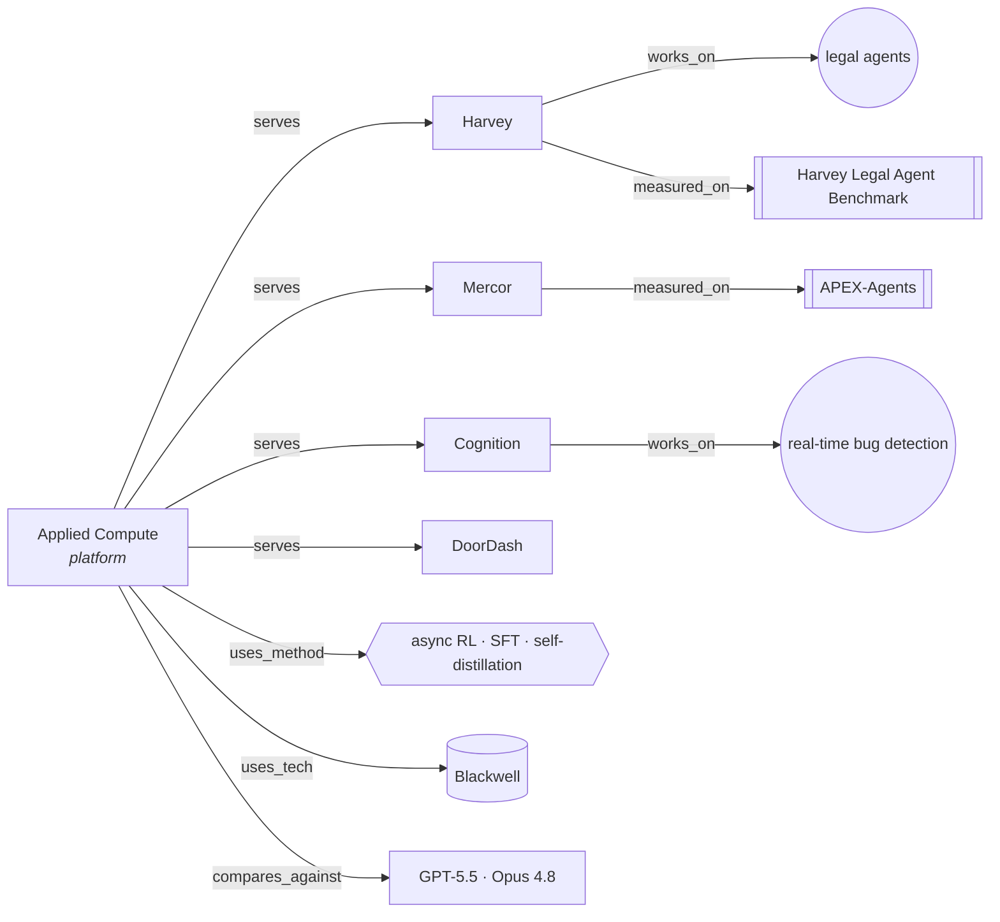
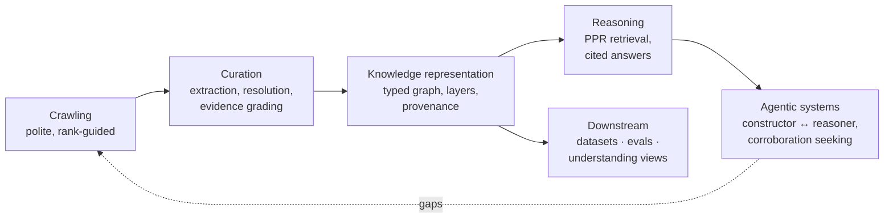

# Connected Frontiers

> A knowledge graph of the frontier-AI research and industry ecosystem: who serves whom, on which
> problems, with which methods, measured on which benchmarks, on what infra, and hiring for which
> skills. It is **built the PageRank way** by a rank-guided crawler, and **explained** by a reasoner
> that cites its evidence.

**Status (2026-11-21):** v0 runs end to end. Crawl → clean → extract → verify (with escalation)
→ grade → resolve → rank → explore → report, plus HF Hub lineage, silver labels, agents and a
use-case benchmark. Numbers are in [EVAL.md](EVAL.md#results-log) and [reports/](reports/).

| v0 at a glance | |
|---|---|
| Graph | 245 pages · 50 publishers · 3,433 entities · ~3.7k edges (225 verified) · 43 named segments |
| Quality vs silver labels | verifier accuracy 0.89, false support 0.14 · ER accuracy 0.85, false merges 0.17 |
| Agents (KG tools vs closed-book) | 0.67 vs 0.14 (Mistral-Small-2603) · 0.64 vs 0.17 (Inkling-2-mini) |
| Cost | $0.0017 per verified edge · about $1.7 spent in total |


---

## Why

The ecosystem changes weekly, and the connections that explain it are spread across company pages,
case studies, research blogs, papers, leaderboards and job posts. One page already holds a lot.
Applied Compute's `/training` page alone gives about 25 typed edges:



*(These are claims from the page, stored as `claimed` until corroborated.)*

Following these links recursively, ranked so that **things reached by several paths rise**, is
how the graph grows.

## What it's for

Think **Connected Papers, but for the whole ecosystem**: not just papers citing papers, but labs,
neolabs, startups, infra, customers, problems, methods, benchmarks, models, roles and skills, with
every link backed by graded evidence.

| Who | Use |
|---|---|
| Researchers and engineers | see who works on a problem, with which methods, measured how; find gaps; pick projects |
| Newcomers and professionals | build a mental model of the stack, layer by layer; see which skills the frontier hires for |
| Agents | a grounded, cited knowledge source to reason over (the Reasoner), instead of model memory |
| Dataset and eval builders | curated, provenance-carrying data; a 5-task benchmark ([docs/DATASET.md](docs/DATASET.md)) |

It is also a **practice ground for the whole chain**, with each stage measured:



## How it works

| Part | What it does | Where |
|---|---|---|
| 🕸️ **Constructor** ("training") | rank-guided crawl → extract → resolve → graph, improving over rounds | `src/cf/crawl`, `extract`, `resolve`, `graph`, `rank` |
| 🧠 **Reasoner** ("inference") | answers questions from the graph, cites every claim, asks for crawls when it finds gaps | `src/cf/reason` |
| 🗺️ **Understanding views** | stack map, entity cards, guided tours, method diffusion, what changed | `src/cf/viz` |
| 📏 **Eval harness** | every component scored against frozen gold sets and baselines | `src/cf/eval`, [EVAL.md](EVAL.md) |
| 🤗 **Release** | KG snapshot and a 5-task benchmark on Hugging Face | [docs/DATASET.md](docs/DATASET.md) |

The core experiment: does **personalized-PageRank "push" crawling** reach the relevant
ecosystem in fewer fetches than **BFS**? Details are in [docs/DESIGN.md §3](docs/DESIGN.md#3-the-crawl-algorithm-and-estimating-coverage).

## Quickstart

Requires Python ≥ 3.11 and [uv](https://docs.astral.sh/uv/).

```bash
make setup          # creates .venv, installs deps, creates .env from .env.example
# edit .env  → OPENROUTER_API_KEY=...   (HF_TOKEN optional if `hf auth login` was done)
make doctor         # checks keys (presence only), configs, folders
make test           # runs the test suite
uv run cf --help    # crawl · rank · ask · viz · eval · release
```

Optional extras: `uv sync --extra extract-baseline` (GLiNER, pulls torch), `--extra resolve`,
`--extra data`, `--extra release`, `--extra js` (Playwright).

## Commands

| Command | Does | Milestone |
|---|---|---|
| `cf doctor` | environment and config check | ✅ |
| `cf scout --pages 6 --hop2-orgs 25` | multi-seed crawl → extract → verify → explorer | ✅ |
| `cf build` | rebuild graph from cache + HF adapter + ER + segments + report | ✅ |
| `cf silver --version v1` | ensemble silver labels; owner dispute queue | ✅ |
| `cf tasks` / `cf bench` | use-case tasks from the KG; agent benchmark + leaderboard | ✅ |
| `cf crawl --policy bfs --budget 200` | Constructor crawl from `configs/seeds.yaml` | M1 / M3 |
| `cf rank --seed "Applied Compute"` | PageRank, personalized PageRank, HITS | M3 |
| `cf ask "who trains legal agents?" --system R3` | cited answer | M5 |
| `cf viz` | build the explorer | M6 |
| `cf eval --suite crawl` | score against gold | M1+ |
| `cf release --dry-run` | build the HF dataset locally | M6 |

## Project layout

```
connected-frontiers/
├── README.md · PROBLEM.md · EVAL.md · DECISIONS.md
├── pyproject.toml · Makefile · .env.example
├── docs/       DESIGN.md · DATASET.md · architecture.svg
├── configs/    seeds.yaml · crawl.yaml · eval.yaml
├── src/cf/     cli · config · interfaces · crawl/ extract/ resolve/ graph/ rank/ reason/ viz/ eval/ llm/
├── tests/      notebooks/
├── data/       raw/ interim/ processed/ (gitignored) · samples/
└── eval/       gold/ (frozen) · results/ (gitignored)
```

## Documents

| Doc | Read it for |
|---|---|
| [PROBLEM.md](PROBLEM.md) | north star, user, task, objective: the eight objects |
| [docs/DESIGN.md](docs/DESIGN.md) | architecture, layers, crawl algorithm, coverage estimation, understanding views |
| [EVAL.md](EVAL.md) | metrics, frozen test sets, baselines, results log |
| [docs/EVIDENCE.md](docs/EVIDENCE.md) | truth vs claim: evidence grading, Reasoner wording rules |
| [docs/DATASET.md](docs/DATASET.md) | Hugging Face dataset and benchmark plan |
| [DECISIONS.md](DECISIONS.md) | dated decisions and open questions |

## Principles

- **Algorithms decide, models judge.** Crawl policy and stopping rules are algorithms, so they
  can be compared. Models handle reading and judgment, and each has a non-LLM baseline.
- **Claim ≠ fact.** Every edge is graded by its citations: who says it (self, counterparty,
  independent record, press), how many independent publishers back it, and whether the quote
  really supports it. The ladder runs unsupported → claimed → confirmed → corroborated → verified,
  with contested and stale flags. Answers must word claims as claims. See
  [docs/EVIDENCE.md](docs/EVIDENCE.md).
- **Measured, not asserted.** Coverage is estimated, improvements show learning curves, and
  failures are logged.
- **Polite crawling.** Respect robots.txt, rate-limit requests, cache raw pages, no logins, and no
  personal data.
