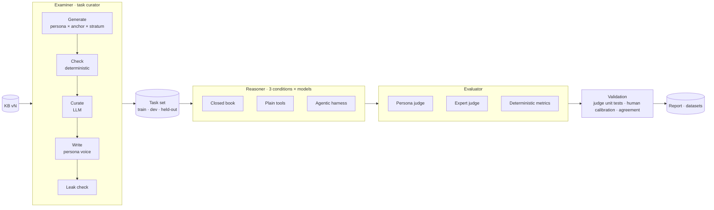

# Agency eval: does grounding in Connected Frontiers give people better guidance?

Status: pilot run, 2026-11-22 (results in §13) · Owner decisions marked **[owner]**

## 1. The question

People who want to act in this field (a student picking a capstone, an engineer moving into post-training, a
forward-deployed engineer meeting a customer) need to decide **what to learn, what to build and what to test
next**. A chat model answers from memory: fluent, generic, possibly stale, unsourced. Search returns pages, not
connections. This eval asks whether an agent that **researches the Connected Frontiers graph** gives guidance that
is more current, more specific and more useful to that person, and whether a **small grounded model can match a
large model answering from memory**.

It is not QA: there is no single right answer. Quality is judged against the person's goal and constraints, and
against what the field is actually doing.

## 2. Hypotheses (written before running)

| | Hypothesis | Primary measure |
|---|---|---|
| H1 | Agentic grounding beats memory for the same model | persona-judge pairwise preference, agentic vs closed book |
| H2 | The harness matters: agentic beats a plain tool loop | pairwise, agentic vs plain tools |
| H3 | A small grounded model matches a large ungrounded one | pairwise, small agentic vs large closed book (non-inferiority, margin 0.10) |
| H4 | Gains come from frontier relevance and insight, not length | expert-judge dimensions + length-matched win rate |
| H5 | Grounding does not hurt where the graph is thin | win rate in the thin stratum ≥ 0.45 |

A hypothesis is supported when its 95% interval clears the threshold; otherwise it is reported as not supported.

## 3. System

Model families are kept apart by role: **Gemma** curates and writes tasks; **Inkling, Qwen** (and DeepSeek if budget
allows) are tested; **GLM and Nemotron** judge. No judge evaluates its own family.

## 4. Personas

Each persona is a profile, used three times: to write the task in that voice, to condition the persona judge, and
to check fit. The catalogue is [`configs/personas.yaml`](../configs/personas.yaml) (8 personas); experiments pick
personas by key.

| Key | Persona | Anchor | Constraint | Success looks like |
|---|---|---|---|---|
| `undergrad_capstone` | Final-year CS undergrad, PyTorch basics | method | 10-12 weeks, a laptop, one rented GPU | a working project with a clear evaluation; something for interviews |
| `masters_thesis` | ML master's student, comfortable with Hugging Face | method | 6 months, a few A100s, a thesis | a research question, a baseline, controlled experiments, maybe a workshop paper |
| `phd_first_year` | strong maths and ML, looking for a 3-4 year direction | method | a year to a first paper, modest compute | who works on what, the open problems, a first project that leads somewhere |
| `career_switcher` | backend engineer moving into ML | method | evenings for 3 months, ~$100 compute | portfolio projects with real tools and production sense |
| `junior_ml_engineer` | one year in an ML team | technology | a quarter, team infrastructure | a scoped project with measurable impact the team can maintain |
| `senior_research_engineer` | trains models at scale, reads papers weekly | method | a quarter, a small cluster, reproducible | a sharp hypothesis, current baselines, controlled experiments |
| `applied_ml_startup` | generalist shipping LLM features | technology | weeks, production, small budget | a stack choice with trade-offs and go/no-go metrics |
| `forward_deployed` | customer-facing, broad stack | org | two weeks before the first customer meeting | the customer's stack and practices, a prototype plan, first metrics |

### Use cases the personas cover

| Use case | What the person needs | Personas | What the graph can add (the hypothesis) |
|---|---|---|---|
| **Learn** a method | an ordered path from basics to current practice | undergrad, career switcher | which tools and data current teams actually use |
| **Research** a direction | open problems, who works on them, a first project | master's, PhD, senior RE | who does what, where the gaps are, current baselines |
| **Build** a portfolio / own an area | a project that proves the skill | career switcher, junior MLE | the stacks employers hire for (`hires_for`, `uses_tech`) |
| **Adopt** a technology | vendors, trade-offs, go/no-go metrics | applied ML (startup) | who offers it, who uses it, alternatives |
| **Deploy** at a customer | the customer's stack and likely pain points | forward-deployed | the organisation's own `uses_tech`, `works_on`, hiring |

Pilot evidence (§13) suggests the graph helps most where the answer depends on **specific, current facts about
organisations** (adopt, deploy, build-for-employers) and least where the task is **learning or researching a
well-known method**, which the model already knows.

Use cases not yet covered (candidates, **[owner]** decides whether to add): a hiring manager scoping a role, an
educator building a course, an analyst mapping a market segment, a founder looking for a gap. Each would be one more
persona in the catalogue, with no code change.

## 5. Task set (Examiner)

| Step | What happens | Gate |
|---|---|---|
| Generate | persona × anchor: methods for learners and research engineers, customer organisations (with known stack edges) for FDEs, technologies for applied engineers. Stratified: **rich** (≥ 6 salient neighbours, ≥ 2 relation types) and **thin** (2-5) | anchor not generic, AI-relevant |
| Curate | Gemma: "Is this a meaningful thing for this persona to learn, build or deploy?" | rejects study-design terms, slogans, jargon |
| Write | Gemma rewrites the request in the persona's voice with goal and constraints | leak check: no salient entity names added |
| Reference | the Examiner stores, per task, the salient entities and their facts (for metrics and the judges' fact sheet) | ≥ 2 salient entities |

Size: 16 tasks for v1 (8 personas × 2: 1 rich, 1 thin), so every use case in §4 is covered and H5 has a thin
stratum. The Examiner oversamples ×4 and caches its outputs, so a task set is reproducible from its seed. Splits: dev (harness and prompt changes) and held-out
(reported results only). Every task is pinned to its KB version and released.

## 6. Conditions

| Condition | What the model gets |
|---|---|
| Closed book | the request only |
| Plain tools | graph tools, one free loop |
| Agentic harness | plan → multi-step research → evidence gate → notes (findings with edges and implications) → coverage reflection → advice built from findings → synthesis check |
| Agentic + fit (`kg_agentic+fit`) | the same, with the profile in context, scope rules and a prerequisite gate. Tested on dev, not promoted (§13) |

Ablations switch harness steps off by name, e.g. `kg_agentic:read,reflect`.

Planned (backlog): `web_agentic` (web search instead of the graph, same harness) and `kg_web_agentic` (both), to test
whether the graph beats or complements open web search.

Models: small Inkling-2-small and Qwen3.5-35B-A3B; large Qwen3.5-397B-A17B (same family as the small Qwen, so scale is
compared without a family change). DeepSeek-V4-Pro is optional **[owner: budget]**.

## 7. Evaluator

Two judges with different roles, each played by both judge models, plus deterministic metrics.

**Context every judge gets:** the persona profile, the request with its constraints, the answer(s) with sources and
tool mentions removed, and a **symmetric fact sheet**: one reference card for every entity named in either answer
(from the KB; "not in reference" does not mean false). The judge is never told which condition produced an answer.

### Persona judge (the asker)

Role-plays the persona profile. Asks: would I act on this, and which would I rather have?

| Dimension | 1 | 3 | 5 |
|---|---|---|---|
| Usefulness to me | generic; I learn nothing new | some useful steps | changes what I would do this week |
| Fit to my situation | ignores my skills or constraints | partly fits | fits my background, time and compute |
| Would act on it | no | maybe | yes, starting now |

Plus a pairwise preference (both orders) with a short reason.

### Expert judge (a frontier practitioner)

| Dimension | 1 | 3 | 5 |
|---|---|---|---|
| Frontier relevance | dated or generic practice | current mainstream | reflects what leading teams do now: methods, tools, organisations |
| Insight | a tutorial list anyone could find | some useful connections | non-obvious, specific connections that change the plan (who does what, where the gaps are) |
| Actionability and feasibility | vague, or infeasible under the constraints | concrete but partly feasible | concrete first steps and stack, feasible as stated |
| Experiment rigor | no real experiment | a question and a measure | question, baseline, one controlled change, measure, and a threat to validity |
| Accuracy and honesty | invented or wrong claims | mostly right, unqualified | correct; uncertainty and self-claims flagged |

Rationale is written before scores. Length is not quality.

### Deterministic metrics

Share of named items that exist in the graph · salient entities surfaced (in advice and in findings) · findings with
valid edges · projects built on findings · evidence reads · plan coverage · length.

## 8. Validating the evaluator (before trusting it)

| Check | How | Pass |
|---|---|---|
| **Judge unit tests** | perturb 10 good answers four ways: make generic (remove specifics), inject one false claim (a non-existent tool or company), break the constraints (needs 8 GPUs), strip the experiments' baselines | the targeted dimension drops in ≥ 80% of cases |
| Position bias | every pairwise judgement in both orders | consistency reported; inconsistent pairs count as ties |
| Agreement | two judge models per role | Cohen's κ reported; κ < 0.3 → results flagged |
| Human calibration | blind review sheet, 12 pairs, **[owner]** | agreement with judge majority reported |
| Self-preference | judge families never tested | by design |
| Length | equal output caps; length-matched win rate | reported beside the main result |

## 9. Analysis

Unit = task (paired across conditions). Pairwise preference as P(first preferred) with 95% task-bootstrap intervals,
per persona and stratum. Rubric means per dimension with intervals. H3 uses non-inferiority (lower bound ≥ 0.40).
Five hypotheses, so intervals are read with that in mind; no single cell is a headline on its own.

## 10. Outputs

| Dataset (HF release) | Contents |
|---|---|
| `bench/agency_tasks` | persona, profile, request, constraints, anchor, stratum, salient entities, KB version |
| `runs/agency_trajectories` | per run: plan, every tool step with reasoning text and touched ids, findings, advice, metrics |
| `labels/agency_judgments` | rubric scores with rationales, pairwise preferences in both orders, judge, role |

Plus the showcase page (questions with all answers side by side, including where grounding did not help) and the report.

## 11. Phases and cost (estimates)

| Phase | What | Cost |
|---|---|---|
| A · pilot | judge unit tests + 4 dev tasks end to end | ~$1.5 |
| B · v1 | 16 tasks × 3 small/large models × 3 conditions, both judges, both roles | ~$5 |
| C · optional | DeepSeek-V4-Pro as a second large model | ~$2.5 |

Phase B runs only if phase A's judge unit tests pass.

## 12. Known risks

- The fact sheet comes from the KB; a judge may still favour names it can see described. Mitigated by giving cards
  for both answers' names, and checked by the false-claim unit test.
- "Frontier relevance" depends on what the judges know; their training cutoff limits it.
- Persona role-play is a proxy for real users; the owner's blind review is the anchor.

## 13. Results so far

Ledger: [`eval/experiments.jsonl`](../eval/experiments.jsonl). Run folders: `eval/experiments/<name>/<stamp>/`.

| Run | What | Valid | Spend |
|---|---|---|---|
| `agency_pilot/20261122-0059` | pilot, 4 dev tasks, Inkling-2-small | **no**: blinding bug stripped lists from the answers the judges saw (ledger correction) | $0.16 |
| `agency_pilot/20261122-0103` | the same answers re-judged with the fixed rendering | yes | $0.21 |
| `agency_fit_dev/20261122-0106` | memory vs agentic vs agentic+fit, GLM judge | yes | $0.33 |

**Judge unit tests pass** after sharpening the rubric anchors (no baseline → rigour ≤ 2; a plan the person can't
run → fit ≤ 2): GLM catches 100% of degraded answers, Nemotron 92%.

**H1 (grounding beats memory): mixed, split by use case.** On 4 tasks the absolute scores favour memory (persona
judge 4.79 vs 4.17 in the pilot). Pairwise, grounding wins for the forward-deployed engineer (1.00) and the career
switcher (0.75-1.00), and loses for the undergrad capstone (0.00) and the senior research engineer (0.00-0.25).
Agentic vs memory moved from 0.56 to 0.44 between runs, so 4 tasks cannot settle it.

**Fit-first: not promoted.** It did not win back the undergrad and senior RE tasks (vs memory 0.38), and the persona
judge scored it lower (3.92).

**H2-H5: not yet run.** H3 (small grounded vs large from memory) and H5 (thin graph) need the 16-task v1 set.

**Measured judge biases** (pilot 0103, 64 pairwise judgements):

| Bias | Finding | Response |
|---|---|---|
| Position | first-shown answer wins 62%; order-consistent 69% | both orders kept; inconsistent pairs count as ties |
| Length | none (r = −0.15 / −0.25) | none needed |
| Leniency / ceiling | GLM scores 4-5 in 95% of cases, Nemotron 81% | planned: yes/no checklist items instead of 1-5 scales |
| Agreement | GLM vs Nemotron r = 0.31 | flagged; owner blind review as the anchor |
| Familiarity (suspected) | memory answers name 49% of items not in the KB vs 26% for agentic; accuracy correlates +0.39 with that share | planned: controlled swap test (famous-but-wrong name vs fake name) |

**Next** (pending approval): a memory-first, graph-enriched harness variant (draft from memory, then research the
graph for organisations, tools, data and hiring), checklist scoring, the familiarity test, and the 16-task v1 set
covering all eight personas.

### Typed checklist: code vs Jev vs LLM judges (2026-11-22)

13 yes/no items (`cf/bench/checklist.py`), each scored by deterministic code (abstains where a rule cannot
decide), TypeSafe **Jev 1.14** (a "System One" typed evaluation model, via OpenRouter's Decisions API; one `noul`
question per item, returns P(yes)) and two LLM judges (evidence per item, then yes/no). Re-score of the 12 cached
answers of `agency_fit_dev/20261122-0106` with `cf checklist`; $0.19 in total, of which Jev $0.005.

| Scorer | Mean P(yes) by condition (memory · agentic · fit) | Defects caught | generic | made-up tool | infeasible | no baseline | Theano (famous, dated) | made-up name | Familiarity gap |
|---|---|---|---|---|---|---|---|---|---|
| code | 0.85 · 0.95 · 0.85 | 100% (n 20) | 100% | abstains | 100% | 100% | abstains | abstains | – |
| Jev 1.14 | 0.69 · 0.70 · 0.77 | 79% (n 29) | 38% | 100% | 100% | 88% | 100% | 100% | 0.0 |
| GLM-5.3 | 0.93 · 0.95 · 0.98 | 91% (n 34) | 62% | 100% | 100% | 100% | 100% | 100% | 0.0 |
| Nemotron 3.5 | 0.91 · 0.96 · 1.00 | 72% (n 36) | 12% | 100% | 100% | 100% | 75% | 50% | −0.25 |

- The LLM judges still sit near the ceiling on yes/no items (GLM answers yes to `fit_compute` on every answer).
  Jev spreads its probabilities more (0.48-0.98 per item), but there is no ground truth yet, so spread is not
  accuracy.
- No scorer separates the conditions on these 4 tasks.
- **Familiarity bias is not supported** here: Jev and GLM catch a famous-but-dated name as often as a made-up
  one, and Nemotron catches the famous one more often. The earlier correlation (§13) was confounded.
- Every model scorer is weak on "generic" answers (specifics stripped); only the code rule catches them reliably.
- Agreement is high in % but κ is mostly 0 or undefined, because nearly every answer gets "yes" (ceiling).
- A first item that combined three questions ("real, current and appropriate") got P(yes) 0.22 from Jev on good
  answers. Split into two atomic items, as TypeSafe advises, it works.

Reading: Jev is a cheap first-pass scorer (about 40× cheaper than the LLM judges here) that catches planted
defects, not a replacement for them. Which scorer is *right* needs human labels: the owner's blind review.

**Blinding leak (found 2026-11-22, fixed):** one agentic answer said "The graph shows production relevance…"; the
filter removed "in the graph" but not "the graph shows", so the judges could see that phrase. It affects one task
(`A-undergrad_capstone-00`, kg_agentic) in pilot 0103 and fit_dev 0106. That answer lost its comparisons (0.00), so
the leak did not favour grounding; the judgements stand, flagged. `_blind` now rewrites it to "the evidence".
