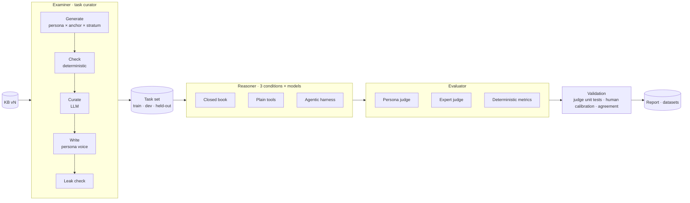

# Agency eval: does grounding in Connected Frontiers give people better guidance?

Status: design, 2026-11-21 · Owner decisions marked **[owner]**

## 1. The question

People who want to act in this field (a student picking a capstone, an engineer moving into post-training, a
forward-deployed engineer meeting a customer) need to decide **what to learn, what to build and what to test
next**. A chat model answers from memory: fluent, generic, possibly stale, unsourced. Search returns pages, not
connections. This eval asks whether an agent that **researches the Connected Frontiers graph** gives guidance that
is more current, more specific and more useful to that person, and whether a **small grounded model can match a
large model answering from memory**.

It is not QA: there is no single right answer. Quality is judged against the person's goal and constraints, and
against what the field is actually doing.

## 2. Hypotheses (written before running)

| | Hypothesis | Primary measure |
|---|---|---|
| H1 | Agentic grounding beats memory for the same model | persona-judge pairwise preference, agentic vs closed book |
| H2 | The harness matters: agentic beats a plain tool loop | pairwise, agentic vs plain tools |
| H3 | A small grounded model matches a large ungrounded one | pairwise, small agentic vs large closed book (non-inferiority, margin 0.10) |
| H4 | Gains come from frontier relevance and insight, not length | expert-judge dimensions + length-matched win rate |
| H5 | Grounding does not hurt where the graph is thin | win rate in the thin stratum ≥ 0.45 |

A hypothesis is supported when its 95% interval clears the threshold; otherwise it is reported as not supported.

## 3. System

Model families are kept apart by role: **Gemma** curates and writes tasks; **Inkling, Qwen** (and DeepSeek if budget
allows) are tested; **GLM and Nemotron** judge. No judge evaluates its own family.

## 4. Personas

Each persona is a profile, used three times: to write the task in that voice, to condition the persona judge, and
to check fit.

| Persona | Background | Typical constraint | Success looks like |
|---|---|---|---|
| Student (capstone) | CS undergrad or master's, knows PyTorch basics | 8-12 weeks, a laptop, one rented GPU | a feasible, current project that shows real skills and leads to a job or a paper |
| Research engineer | ships training code, reads papers | a quarter, a small cluster | a credible research direction with controlled experiments and baselines |
| Applied ML engineer | builds products, some fine-tuning | weeks, production constraints | a stack and a plan that would survive a real deployment |
| Forward-deployed engineer | customer-facing, broad stack | two weeks before a customer | knows the customer's stack and practices, and what to measure on day one |

**[owner]** confirm or edit these four profiles; they are the evaluation's point of view.

## 5. Task set (Examiner)

| Step | What happens | Gate |
|---|---|---|
| Generate | persona × anchor: methods for learners and research engineers, customer organisations (with known stack edges) for FDEs, technologies for applied engineers. Stratified: **rich** (≥ 6 salient neighbours, ≥ 2 relation types) and **thin** (2-5) | anchor not generic, AI-relevant |
| Curate | Gemma: "Is this a meaningful thing for this persona to learn, build or deploy?" | rejects study-design terms, slogans, jargon |
| Write | Gemma rewrites the request in the persona's voice with goal and constraints | leak check: no salient entity names added |
| Reference | the Examiner stores, per task, the salient entities and their facts (for metrics and the judges' fact sheet) | ≥ 2 salient entities |

Size: 16 tasks for v1 (4 personas × 4: 3 rich, 1 thin). Splits: dev (harness and prompt changes) and held-out
(reported results only). Every task is pinned to its KB version and released.

## 6. Conditions

| Condition | What the model gets |
|---|---|
| Closed book | the request only |
| Plain tools | graph tools, one free loop |
| Agentic harness | plan → multi-step research → evidence gate → notes (findings with edges and implications) → coverage reflection → advice built from findings → synthesis check |

Models: small Inkling-2-small and Qwen3.5-35B-A3B; large Qwen3.5-397B-A17B (same family as the small Qwen, so scale is
compared without a family change). DeepSeek-V4-Pro is optional **[owner: budget]**.

## 7. Evaluator

Two judges with different roles, each played by both judge models, plus deterministic metrics.

**Context every judge gets:** the persona profile, the request with its constraints, the answer(s) with sources and
tool mentions removed, and a **symmetric fact sheet**: one reference card for every entity named in either answer
(from the KB; "not in reference" does not mean false). The judge is never told which condition produced an answer.

### Persona judge (the asker)

Role-plays the persona profile. Asks: would I act on this, and which would I rather have?

| Dimension | 1 | 3 | 5 |
|---|---|---|---|
| Usefulness to me | generic; I learn nothing new | some useful steps | changes what I would do this week |
| Fit to my situation | ignores my skills or constraints | partly fits | fits my background, time and compute |
| Would act on it | no | maybe | yes, starting now |

Plus a pairwise preference (both orders) with a short reason.

### Expert judge (a frontier practitioner)

| Dimension | 1 | 3 | 5 |
|---|---|---|---|
| Frontier relevance | dated or generic practice | current mainstream | reflects what leading teams do now: methods, tools, organisations |
| Insight | a tutorial list anyone could find | some useful connections | non-obvious, specific connections that change the plan (who does what, where the gaps are) |
| Actionability and feasibility | vague, or infeasible under the constraints | concrete but partly feasible | concrete first steps and stack, feasible as stated |
| Experiment rigor | no real experiment | a question and a measure | question, baseline, one controlled change, measure, and a threat to validity |
| Accuracy and honesty | invented or wrong claims | mostly right, unqualified | correct; uncertainty and self-claims flagged |

Rationale is written before scores. Length is not quality.

### Deterministic metrics

Share of named items that exist in the graph · salient entities surfaced (in advice and in findings) · findings with
valid edges · projects built on findings · evidence reads · plan coverage · length.

## 8. Validating the evaluator (before trusting it)

| Check | How | Pass |
|---|---|---|
| **Judge unit tests** | perturb 10 good answers four ways: make generic (remove specifics), inject one false claim (a non-existent tool or company), break the constraints (needs 8 GPUs), strip the experiments' baselines | the targeted dimension drops in ≥ 80% of cases |
| Position bias | every pairwise judgement in both orders | consistency reported; inconsistent pairs count as ties |
| Agreement | two judge models per role | Cohen's κ reported; κ < 0.3 → results flagged |
| Human calibration | blind review sheet, 12 pairs, **[owner]** | agreement with judge majority reported |
| Self-preference | judge families never tested | by design |
| Length | equal output caps; length-matched win rate | reported beside the main result |

## 9. Analysis

Unit = task (paired across conditions). Pairwise preference as P(first preferred) with 95% task-bootstrap intervals,
per persona and stratum. Rubric means per dimension with intervals. H3 uses non-inferiority (lower bound ≥ 0.40).
Five hypotheses, so intervals are read with that in mind; no single cell is a headline on its own.

## 10. Outputs

| Dataset (HF release) | Contents |
|---|---|
| `bench/agency_tasks` | persona, profile, request, constraints, anchor, stratum, salient entities, KB version |
| `runs/agency_trajectories` | per run: plan, every tool step with reasoning text and touched ids, findings, advice, metrics |
| `labels/agency_judgments` | rubric scores with rationales, pairwise preferences in both orders, judge, role |

Plus the showcase page (questions with all answers side by side, including where grounding did not help) and the report.

## 11. Phases and cost (estimates)

| Phase | What | Cost |
|---|---|---|
| A · pilot | judge unit tests + 4 dev tasks end to end | ~$1.5 |
| B · v1 | 16 tasks × 3 small/large models × 3 conditions, both judges, both roles | ~$5 |
| C · optional | DeepSeek-V4-Pro as a second large model | ~$2.5 |

Phase B runs only if phase A's judge unit tests pass.

## 12. Known risks

- The fact sheet comes from the KB; a judge may still favour names it can see described. Mitigated by giving cards
  for both answers' names, and checked by the false-claim unit test.
- "Frontier relevance" depends on what the judges know; their training cutoff limits it.
- Persona role-play is a proxy for real users; the owner's blind review is the anchor.
