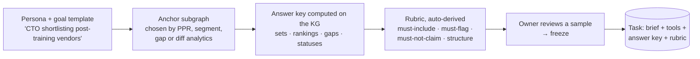

# Use-case benchmark: agents doing real ecosystem work, grounded on the KG

> Not trivia. Each task is a **job someone actually does** with ecosystem knowledge (map a market,
> shortlist vendors, find open problems, audit claims, plan a skill path). The KG makes these
> gradable: the **answer key and rubric are computed from the graph**, so long-form, open-ended
> work can be scored automatically and repeatably.

Status: design v2 (2026-11-21), replacing the lookup-style draft. Fact lookups survive only as
**probes** (§6) that diagnose *why* an agent failed a real task.

## 1. Principle: answer keys from graph computation, not hand-writing

An agent's output is decomposed into **atomic claims**. Each claim is checked against the KG:
supported, unsupported, or contradicting; and stated with the right confidence for its evidence
status. This is the FActScore idea (Min et al. 2023, unverified) applied with a KG as the
reference, instead of a single Wikipedia page.

## 2. Task suite (v1): nine use cases

| # | Use case · persona | Brief (example) | Answer key computed from the KG | Graded on |
|---|---|---|---|---|
| U1 | **Landscape map** · analyst | "Map the post-training platform segment: who offers what, to whom, measured how." | segment (community) members; their `offers`, `serves`, `measured_on` edges | entity recall/precision; relation correctness; claim-vs-fact wording |
| U2 | **Vendor shortlist / due diligence** · CTO | "We need RL post-training for a legal agent. Shortlist 3 vendors with evidence; flag what's only self-claimed." | orgs with `offers`/`uses_method` on the method + legal-adjacent customers, ranked by evidence strength | shortlist overlap with key; every reason cited; claims flagged |
| U3 | **Gap finding** · independent researcher | "Find problems with benchmarks but few providers; propose two projects an individual could do." | problems with ≥1 `measured_on` benchmark and ≤1 provider (graph query) | gap validity (in the computed set); grounding; feasibility rubric |
| U4 | **Method diffusion** · research lead | "How has self-distillation spread: who introduced it, who uses it, in what products?" | `introduces`/`uses_method`/`offers` around the method, with dates | coverage; chronology; source fidelity |
| U5 | **Claim audit** · journalist / buyer | "Audit these 8 marketing claims: which are corroborated, which are self-claims, what would verify each?" | edge statuses + grading reasons (EVIDENCE.md) | status agreement; right corroboration channel proposed |
| U6 | **Go-to-market targeting** · founder | "We sell evals for coding agents. Which 10 companies are the most likely buyers, and why?" | orgs working on coding agents / serving them, by PPR from the problem node | ranking quality (nDCG vs key); evidence per pick |
| U7 | **Skill path** · engineer job-seeker | "I want to join a post-training neolab. What roles, skills and methods recur? Plan 8 weeks." | `hires_for`/`requires` + methods used by the segment | grounding of every skill/role; plan coherence rubric |
| U8 | **What changed** · competitive intel | "Since the last snapshot, what changed around Modal and why does it matter?" | snapshot diff on Modal's 2-hop neighbourhood | diff recall; no invented changes |
| U9 | **Forecast** · investor / strategist | "Which partnerships or adoptions around X are likely next?" | **held-out future edges** (graph frozen at T, edges after T) | hits@k against what actually happened |

U9 is the strongest signal: it's graded by **reality**, not by our labels.

## 3. Multi-turn analyst sessions

Real work is iterative. A session is a sequence of 3–5 turns where the goal sharpens:

> T1 "Map inference-cloud providers." → T2 "Only those serving AI-native apps." → T3 "Which of
> them claim cost advantages, and how well supported is that?" → T4 "Draft a one-paragraph
> recommendation for a startup."

Generated by walking the use-case templates through the graph: each turn **filters, pivots or
deepens** the previous turn's answer set. Each turn has its own computed answer key. Graded per
turn, plus **session success**: the final deliverable is correct and grounded, and earlier
constraints are kept.

## 4. Grading (automatic, then calibrated)

| Signal | How |
|---|---|
| Coverage | recall of must-include entities and relations from the answer key |
| Precision / hallucination | atomic claims → KG lookup; unsupported or contradicting claims counted |
| Epistemic honesty | CLAIMED facts phrased as claims; contested facts shown as contested (EVIDENCE.md §5) |
| Citation fidelity | cited edge ids actually support the sentence they're attached to |
| Ranking quality | nDCG / overlap for shortlist and targeting tasks (U2, U6) |
| Reality check | hits@k on future edges (U9) |
| Deliverable rubric | structure, actionability, feasibility (LLM judge, calibrated with owner labels, κ ≥ 0.7) |
| Efficiency | tool calls, tokens, $ per task, latency |

## 5. Harness and conditions

One loop, any OpenRouter model. Tools: `find_entity`, `neighbors`, `ppr`, `paths`, `evidence`,
`segment(id)`, `gaps(filters)`, `diff(id, since)`.

| Condition | Gives the model |
|---|---|
| closed-book | nothing (memory only) |
| text RAG | top-k evidence quotes |
| KG tools | the tool loop |
| oracle subgraph | the answer key's subgraph handed over |

The gap between **oracle and KG tools** is the *retrieval and planning* problem. The gap between
**oracle and perfect** is the *reasoning and synthesis* problem.

## 6. Probes (diagnostics, not the benchmark)

Lookup, multi-hop, lineage, absence and false-premise probes, generated from the same KG. When an
agent fails U2, the probes show whether it couldn't *find* the vendors, couldn't *follow* the path,
or *overstated* a claim.

## 7. Related work (from memory, unverified until read)

GAIA (Mialon et al. 2023), tool-using assistant tasks · τ-bench (2024), multi-turn agent–user
tasks with policies · BrowseComp (2025), hard-to-find web facts · DeepResearch Bench (2025),
long-form research reports · FActScore (2023), atomic-claim precision.

What's new here, as far as I know: **answer keys and rubrics computed from a graded KG**, so the
tasks are realistic yet automatically scorable, plus **forecast tasks graded by future
snapshots**. Field vs ours: KG-grounded long-form evaluation exists in pieces; this combination is
ours to demonstrate.

## 8. Owner decisions

- Which use cases go in v1. Proposed: U1, U2, U3, U5, U6 plus multi-turn sessions. U9 needs two
  snapshots in time, so it comes later.
- Size: proposed about 15 tasks per use case plus 20 sessions for v1, with owner review of
  every task (they're few and substantial).
- Models: gpt-oss-120b, qwen3-30b-instruct, deepseek-v4.1-flash, nemotron-3-super,
  mistral-small-3.2, inkling-2-mini.
