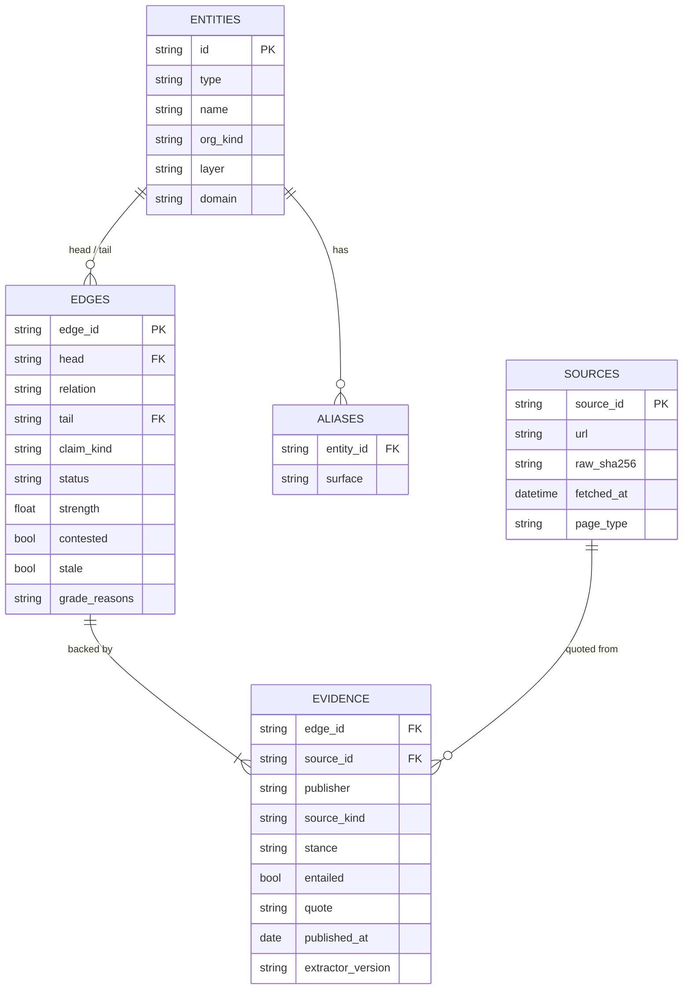
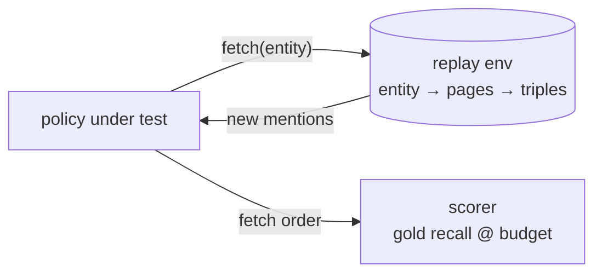

# Dataset and benchmark release plan (Hugging Face)

> Status: plan. Nothing is released until the licensing check in §5 has passed and the test sets
> have been frozen.

The crawl produces two things worth sharing:

1. **`connected-frontiers-kg`**: a dated snapshot of the ecosystem graph (entities, typed edges,
   provenance).
2. **`connected-frontiers-bench`**: five tasks with frozen gold labels and baseline scores, so
   others can compare crawlers, extractors, resolvers and graph-grounded reasoners.

## 1. Who would use it, and for what

| Use case | Uses |
|---|---|
| Understanding the ecosystem: who serves whom, method adoption, benchmark spread | KG snapshot |
| Focused / budgeted crawling research | CF-Crawl (offline replay environment) |
| Information extraction on real business and technical pages | CF-Extract |
| Entity resolution for organisations, models and benchmarks | CF-Resolve |
| Temporal link prediction on a typed, heterogeneous graph | CF-LinkPred |
| Graph-grounded QA with citations (GraphRAG / HippoRAG-style) | CF-QA |

## 2. KG snapshot: tables

Format: Parquet, one HF config per table, and one snapshot per release tag (`v2026.12`, …).

## 3. Benchmark: five tasks

| Task | Input → output | Split | Metric | Baselines shipped |
|---|---|---|---|---|
| **CF-Crawl** | seeds + budget → ordered fetch list | per seed, gold frozen | gold recall @ {100, 250, 500}; AUC | BFS, degree, PageRank, PPR push |
| **CF-Extract** | page → typed triples | train / held-out pages | triple P / R / F1 | GLiNER + rules, cheap LLM |
| **CF-Resolve** | mention pair → same / different | stratified by type | pairwise P / R | domain match, fuzzy |
| **CF-LinkPred** | graph ≤ T → edges after T | temporal | hits@10, AUC | preferential attachment, common neighbours |
| **CF-QA** | question → answer + cited edge ids | pre/post model cutoff flag | accuracy, citation faithfulness, abstention | R0 no-graph, R1 page RAG |

**How CF-Crawl runs offline.** Live crawling isn't reproducible, so the release ships a **replay
environment**: entity → its pages (URL, hash, page type) → the triples extracted from each page.
A policy "fetches" by looking up a page and sees exactly what our crawler saw. Different policies
can be compared exactly, without hitting anyone's servers.

## 4. Contamination guards

- A canary string goes in every file and the dataset card.
- The CF-QA held-out split stays private; it is scored through a submission script.
- Each question is flagged pre- or post-cutoff, and scores are reported separately for the two
  groups.

## 5. Licensing and ethics: check before release

- Our annotations (labels, gold sets, schema): **CC-BY-4.0** (proposed).
- Page content is **not** redistributed: only URLs, hashes and short quotes (≤ 400 chars) as
  evidence. A fetch script lets users rebuild the text. *Unverified: get a quote-length /
  fair-use read before release.*
- Respect each site's robots.txt and terms; drop sources whose terms forbid it.
- People: none in v1. If added later, public authorship only, with no contact data.
- Marketing claims stay `claimed` and are labelled that way. Every released edge ships its
  status, strength and grading reasons (docs/EVIDENCE.md), so users can filter, e.g. to
  `status >= corroborated`.

## 6. Release checklist

- [ ] Test sets frozen (date in DECISIONS.md)
- [ ] Every source registered in `_commons/catalog/datasets.md`
- [ ] Licensing check (§5) done
- [ ] Dataset card: motivation, collection, schema, coverage estimate, known gaps, biases
      (English-language, US-heavy, self-reported claims), intended uses
- [ ] Baseline scores in the card match `cf eval` output
- [ ] `cf release --no-dry-run` pushes to `HF_DATASET_REPO`
