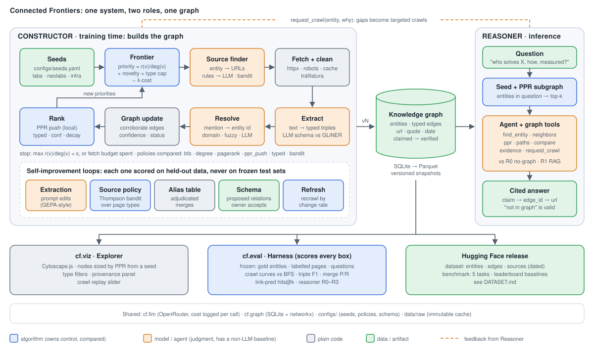
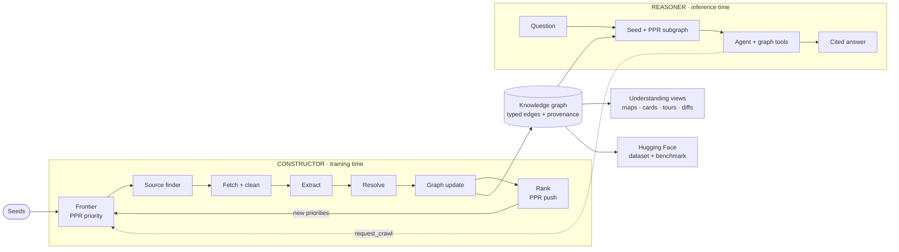
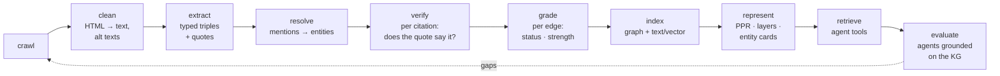
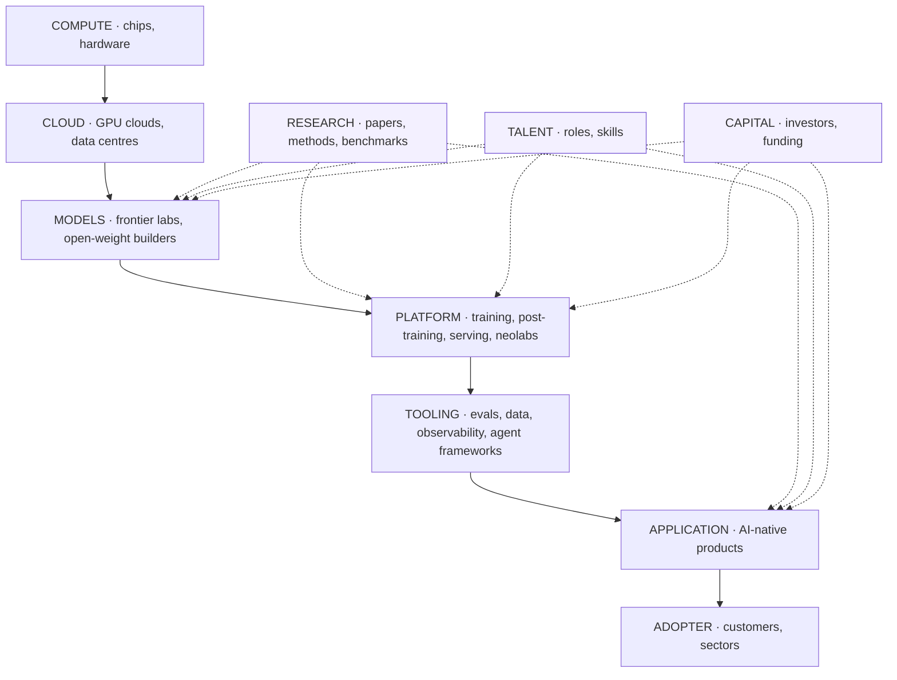
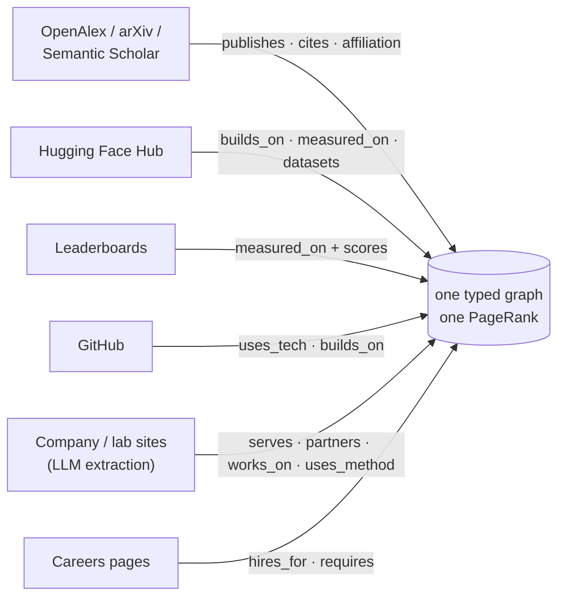
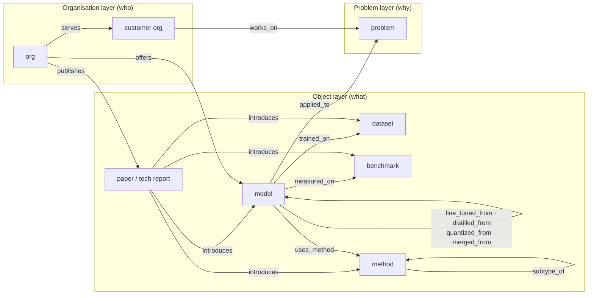
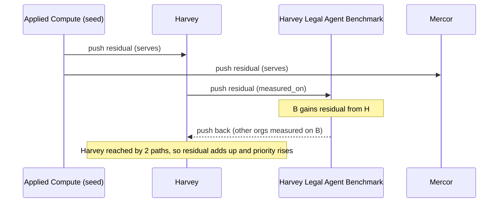
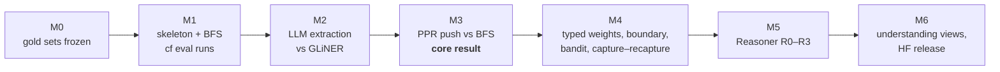

# Connected Frontiers: Design

Last updated: 2026-11-21 · Status: draft for review

**Contents**

0. [Overview: one system, two roles](#0-overview-one-system-two-roles)
1. [Data model and ecosystem layers](#1-data-model-and-ecosystem-layers)
2. [Components](#2-components)
3. [The crawl algorithm, and estimating coverage](#3-the-crawl-algorithm-and-estimating-coverage)
4. [How the Constructor improves over time](#4-how-the-constructor-improves-over-time)
5. [Reasoner](#5-reasoner)
6. [Understanding layer: helping people make sense of it](#6-understanding-layer-helping-people-make-sense-of-it)
7. [Build order](#7-build-order)
8. [Repo layout](#8-repo-layout)

---

## 0. Overview: one system, two roles





### The pipeline, stage by stage



| Stage | What can go wrong | Measured by |
|---|---|---|
| crawl | wrong pages, missed pages | gold recall per fetch |
| clean | content dropped (e.g. customer cards) | chars kept vs visible text |
| extract | missed or invented triples | triple P/R/F1; unquoted-drop rate |
| resolve | false or missed merges | pairwise merge P/R |
| verify | false support or false reject | false-support rate; agreement with labels |
| grade | status not matching human judgment | κ vs owner grades; calibration |
| index / retrieve | right evidence not retrieved | evidence recall@k for gold questions |
| evaluate | agent reasons badly over good evidence | answer accuracy; citation faithfulness; wording matches status |

| Role | Analogy | Job | Output |
|---|---|---|---|
| **Constructor** | training | discover, read, connect, rank | versioned KG snapshot |
| **Reasoner** | inference | answer and explain using the KG, citing evidence | cited answers, and crawl requests for gaps |

**Rule for agents vs algorithms.** Algorithms own *control*: what to crawl, when to stop, how to
rank. Those are what we compare. Models own *judgment*: finding sources, extracting, deciding
merges, reasoning over evidence. Every model step has a non-LLM baseline it must beat.

---

## 1. Data model and ecosystem layers

### 1.1 Layers (how readers orient themselves)

Every entity gets a `layer`, so the graph can be read as a stack.



Example: Applied Compute sits in **PLATFORM**. Harvey and Cognition are in **APPLICATION**.
DoorDash is an **ADOPTER**. Blackwell is **COMPUTE**. Async RL and APEX-Agents are in
**RESEARCH**.

### 1.2 Entities and relations

**Entity types:** `org` (kind: frontier_lab · neolab · startup · infra · customer · investor ·
academic), `problem`, `method`, `benchmark`, `model`, `technology`, `paper`, `role`, `skill`,
`person` (off in v1). The code contract is in [`src/cf/graph/schema.py`](../src/cf/graph/schema.py).

| Relation | From → To | Example |
|---|---|---|
| `serves` | org → org | Applied Compute → Harvey |
| `works_on` | org → problem | Harvey → legal agents |
| `uses_method` | org / paper → method | Applied Compute → async RL |
| `measured_on` | org / model / paper → benchmark | Mercor → APEX-Agents |
| `builds_on` | org / model → model | → Kimi K3 (from a URL slug only, so `claimed`) |
| `uses_tech` | org → technology | Applied Compute → Blackwell |
| `compares_against` | org / model → model | Harvey case → GPT-5.5 |
| `publishes`, `cites` | org → paper, paper → paper | |
| `hires_for`, `requires` | org → role, role → skill | → "forward deployed researcher" |
| `invests_in`, `acquired`, `partners_with` | org → org | Applied Compute → Delegate (acquired) |

**Every edge is a claim with graded evidence.** Each citation carries `source_url · publisher ·
quote · dates · source_kind (self | counterparty | independent_primary | press | aggregator) ·
stance · entailed`. A fixed rule grades the edge to `unsupported → claimed → confirmed →
corroborated → verified`, with `contested` and `stale` flags, a `strength` score and readable
reasons. **Full spec: [EVIDENCE.md](EVIDENCE.md).**

### 1.3 Sources per category (adapters)

The graph covers **every category** (labs, research labs, academia, businesses, industries, papers,
methods, benchmarks, models, systems, infra, roles and skills) in one typed graph, and ranks all of
them together. Each category has a *native* source. Structured sources give **primary,
high-trust edges with no LLM**; LLM extraction is reserved for unstructured pages.



| Adapter | Edge status by default |
|---|---|
| OpenAlex / arXiv, HF Hub metadata, leaderboards, GitHub manifests | `verified` (primary record) |
| Company and lab pages | graded per EVIDENCE.md (usually `claimed`) |

Seeds for PPR can be **any** node type: a method, a benchmark, a lab or a skill.

### 1.4 The object layer: models, methods, benchmarks, datasets (owner direction, 2026-11-21)

The graph goes **all the way down to the technical objects** and back up to the organisations that
build, use and sell them, and the problems they solve.



| New in the schema | Meaning | Best source |
|---|---|---|
| `dataset` entity type | training and eval datasets | HF dataset cards, papers |
| `builds_on` + `derivation` ∈ {fine_tune, distill, quantize, merge, continued_pretrain} | model lineage | HF model card `base_model` (primary), release posts |
| `trained_on` | model → dataset | model cards, tech reports |
| `introduces` | paper/post → method, benchmark, dataset, model | papers (arXiv/OpenAlex), release posts |
| `measured_on` + score attribute | model → benchmark with a number | leaderboards, tech reports |
| `applied_to` | model/method → problem | case studies, papers |

**Sources for objects:** model release pages (web), **technical reports as PDFs** (text via a PDF
parser, or arXiv's HTML versions), HF model and dataset cards (structured), benchmark leaderboards.

**Crawling objects:** seeds and frontier nodes can be *any* type. Each type has its own source
finder: model → card + release post + tech report; method → introducing paper; benchmark → paper
+ leaderboard; dataset → dataset card. PPR runs over the mixed graph, so a model reached from
three labs and two benchmarks rises the same way an org does.

### 1.5 Storage

SQLite tables (`entities`, `aliases`, `sources`, `edges`, `evidence`, `crawl_log`,
`frontier`). Raw HTML is kept unchanged under `data/raw/<sha256>`. Graph views come from networkx;
releases are Parquet. Neo4j only if it is ever actually needed.

---

## 2. Components

Python package `cf` under `src/cf/`. Each component implements an interface in
[`src/cf/interfaces.py`](../src/cf/interfaces.py), so variants can be swapped and compared.

| Module | Job | v0 baseline | v1+ variant (must beat v0) |
|---|---|---|---|
| `cf.crawl` | entity → URLs → raw page → text | rule sources; httpx + protego + cache; trafilatura | LLM source finder; bandit over page types; Playwright for JS pages |
| `cf.extract` | text → typed triples | GLiNER + rules | cheap LLM + Pydantic schema; prompts improved over rounds |
| `cf.resolve` | mention → entity | normalized name + domain key | + rapidfuzz + embeddings + LLM adjudication |
| `cf.graph` | store, corroborate, snapshot | SQLite + networkx | — |
| `cf.rank` | scores and frontier policy | BFS · degree · PageRank | PPR push; typed, confidence and time-decayed PPR; HITS |
| `cf.reason` | question → cited answer | R0 no-graph · R1 page RAG | R2 PPR subgraph · R3 agent + graph tools |
| `cf.viz` | KG → understanding views | static Cytoscape.js page | stack map, entity cards, tours, diffs (§6) |
| `cf.eval` | score everything | `cf eval` → `eval/results/*.jsonl` | — |
| `cf.llm` | model access | OpenRouter, cost logged per call, budget guard | routing by measured precision per dollar |

Orchestration is a plain Python loop. Move to LangGraph only if checkpointing or
human-in-the-loop review becomes real friction (log the reason in DECISIONS.md).

---

## 3. The crawl algorithm, and estimating coverage

### 3.1 Entity-level focused crawl with incremental personalized PageRank

Each entity holds two numbers:

- `p(v)`: settled importance.
- `r(v)`: *residual*, importance that has arrived at v but hasn't yet been passed on.

Expanding an entity settles part of its residual and pushes the rest to its neighbours
(Andersen, Chung & Lang 2006, "push").

```
init:  r[s] = 1/|S| for each seed s;  frontier = S
loop until budget spent  or  max over frontier of r(v)/deg(v) < ε:
    v      = argmax over frontier of priority(v)
    pages  = sources(v)[:k]
    triples= extract(fetch(p)) for p in pages
    graph.add(resolve(triples))                     # corroborate if already seen
    p[v]  += α · r[v]                               # settle
    for u in neighbours(v):                         # push
        r[u] += (1-α) · r[v] · w(v→u) / Σw
    r[v]   = 0
    frontier ∪= new neighbours inside the boundary

priority(v) = r(v)/deg(v) × novelty(v) × type_cap(v) − λ·cost(v)
w(v→u)      = β[relation] × strength(v→u)        # evidence strength, see EVIDENCE.md §4
```



What this gives:

- **Reinforcement through several paths** comes for free, because residual accumulates.
- **A principled stopping rule:** stop when no frontier node holds residual above ε.
- **Incremental updates:** no full recompute after each page.

**Relevance boundary.** Non-AI `customer` orgs are added as nodes but expanded only if their
residual is at least τ *and* they have at least 2 edges into the AI core. Each type has a cap.
This stops DoorDash from pulling in all of food delivery.

**Policies compared** (everything else held fixed): `bfs` · `degree` · `pagerank` · `ppr_push` ·
`ppr_push_typed` · `ppr_push_bandit`.

### 3.2 How much of the "entire" ecosystem do we have? Capture–recapture

There is no complete list of the ecosystem to score against, so we **estimate** its size the way
ecologists count fish. Run two crawls from **independent seed sets in different layers** (e.g.
seeds in MODELS vs seeds in APPLICATION):

- n₁ entities found by crawl A, n₂ by crawl B, m found by both
- Estimated population (Chapman): **N̂ = (n₁+1)(n₂+1)/(m+1) − 1**
- Estimated coverage of the union: **(n₁ + n₂ − m) / N̂**

Caveat: the method assumes every entity is equally likely to be found, which is false here
(large orgs are easier to find). That biases N̂ *down*, i.e. coverage is overstated. Mitigations:
stratify by layer and type, use more than 2 crawls (log-linear models), and report the bias
openly. Status: standard method (Lincoln–Petersen / Chapman); applying it to crawls is our
choice, not yet checked against literature on estimating web-crawl coverage.

---

## 4. How the Constructor improves over time

Each loop must show a learning curve on **held-out** data. Nothing tunes on frozen test sets.

| Loop | Signal | What changes | Shown by |
|---|---|---|---|
| Extraction | errors on labelled *train* pages | prompts and few-shot examples (GEPA/DSPy-style reflective edits) | held-out F1 across rounds |
| Source policy | new-edge yield per page type | Thompson-sampling weights | new edges per fetch vs fixed rules |
| Entity resolution | adjudicated merges | alias table and rules | merge P/R across rounds |
| Schema | agent-proposed relations | owner accepts or rejects | share of "other" triples falls |
| Refresh | change rate per source | recrawl schedule | stale-edge rate |
| Reasoner → Constructor | `request_crawl` gaps | targeted crawls | share of "not in graph" answers falls |

---

## 5. Reasoner

**Graph tools:** `find_entity(name)` · `neighbors(id, rel?, type?)` · `ppr(seeds, k)` ·
`paths(a, b, max_len)` · `evidence(edge_id)` · `compare(ids, facet)` · `request_crawl(entity, why)`.

**Answer contract:** every claim cites an `edge_id`, which resolves to a URL and quote. **The
wording must match the edge's status**: "X claims …" for CLAIMED, "both parties say …" for
CONFIRMED, plain statements only for VERIFIED ([EVIDENCE.md §5](EVIDENCE.md#5-how-the-reasoner-must-speak-language-contract)).
"Not in the graph" is a valid answer and triggers `request_crawl`.

| System | What it sees |
|---|---|
| R0 | nothing: the model alone |
| R1 | vector RAG over raw cached pages |
| R2 | PPR subgraph around the question's entities (HippoRAG-style) |
| R3 | agent that calls graph tools |

All four use the same model.

**Question families:** lookup · multi-hop · comparison · gap-finding · temporal prediction (graph
frozen at T).

---

## 6. Understanding layer: helping people make sense of it

The graph is only useful if people can *read* it. Each view answers one orientation question.

| View | Orientation question | Built from |
|---|---|---|
| **Stack map** | "How does the ecosystem fit together?" | layers as lanes; edges that cross layers |
| **Entity card** | "What is X, and what is it connected to?" | top-k PPR neighbours by relation, evidence quotes, cited summary |
| **Guided tour** | "Walk me from X outward" | ordered walk by PPR from a seed, one sentence per step, each cited |
| **Method diffusion** | "How fast does research reach industry?" | paper date of a method → first org `uses_method` date |
| **Benchmark ↔ customer** | "Which evals matter to buyers?" | benchmarks reached from customer-facing claims |
| **Segments** | "What are the clusters?" | community detection (Leiden/Louvain), labelled by a model with citations |
| **What changed** | "What's new since last month?" | diff between snapshots |

**Key aspects** the views should make visible (seed list; owner to refine):

1. Where value and dependence sit across layers (e.g. how many applications build on how few
   models).
2. How fast research methods move into production (the diffusion lag).
3. Which benchmarks are cited to customers, and which only in papers.
4. What skills and roles the frontier is hiring for.
5. Open-weight vs closed-model dependence.

*Caveat:* PageRank measures link centrality, not merit or quality. The UI says "most connected
from this seed", never "best".

---

## 7. Build order



Each milestone ends with numbers in the EVAL.md results log.

---

## 8. Repo layout

```
connected-frontiers/
├── README.md · PROBLEM.md · EVAL.md · DECISIONS.md   # framework docs (root by convention)
├── pyproject.toml · Makefile · .env.example
├── docs/          DESIGN.md · DATASET.md · architecture.svg
├── configs/       seeds.yaml · crawl.yaml · eval.yaml
├── src/cf/        cli.py · config.py · interfaces.py
│   ├── crawl/  extract/  resolve/  graph/  rank/
│   └── reason/ viz/  eval/  llm/
├── tests/
├── notebooks/     one per milestone experiment
├── data/          raw/ interim/ processed/ (gitignored) · samples/
└── eval/          gold/ (frozen, committed) · results/ (gitignored)
```
