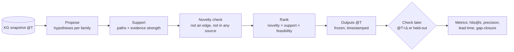

# Discovery on the KG: beyond retrieval and reasoning

> Can an agent grounded on the KG **discover** something, meaning a claim that no single source
> states, that the graph supports, and that can later be **checked**? This doc lists the
> discovery task families, how each is scored without hand-waving, and the baselines it must beat.

Status: brainstorm → design (2026-11-21). Related work is cited from memory and is **unverified
until read**.

## 0. Owner priorities (2026-11-21): read this first

The KG is **knowledge to use**, not a world model. Two directions lead:

**A. Opportunity discovery: "what to build"** (product, platform, idea, problem)

| # | Use | Built from the KG | How we judge it |
|---|---|---|---|
| O1 | **Problem discovery** | problems many orgs work on or customers ask for, but with few products, immature benchmarks, or only self-claimed solutions | evidence count and diversity; owner/expert rating |
| O2 | **White space** (was D3) | problem × method × customer-type cells with demand but ≤1 provider | the cell is real (audited); later: did someone enter? |
| O3 | **Idea briefs** | for a gap: who is near it, what methods and benchmarks apply, the competition map, risks, a first experiment | rubric (specific, grounded, feasible, non-obvious); every claim cited; checked against existing providers |
| O4 | **Pattern mining** | recurring patterns across companies, e.g. "train on the customer's own benchmark", "forward-deployed researchers", "eval-data vendors per vertical" | pattern supported by ≥ N independent orgs; owner judges usefulness |

**B. Education: build a good overview and learn the patterns**

| # | Use | Built from the KG | How we judge it |
|---|---|---|---|
| E1 | **Overview maps** | layers, segments with names, the relation lens | orientation quiz: explorer vs web search (accuracy, time) |
| E2 | **Pattern cards** | O4 patterns explained with 3–5 cited examples | faithfulness (every example backed by edges); owner rating |
| E3 | **Learning paths** | concept prerequisites from the method hierarchy (`subtype_of`), papers and products → "learn X, then Y, see it in Z" | path validity (edges exist); learner self-check |
| E4 | **Guided tours** | a narrated walk outward from a seed ("from Applied Compute to the post-training ecosystem") | factual precision; owner rating |
| E5 | **Self-check quizzes** | questions generated from the graph, with answers from edges | the answer key is the graph; difficulty from hops |

**Deprioritized for now:** financial and funding data, partnership and investment forecasting,
the world-model framing (W1–W5), people. They stay below as backlog, not as the plan.

## 1. What counts as a discovery (the bar)

A discovery is accepted only if it is:

1. **Novel w.r.t. the graph:** not an existing edge, and not stated by any single cited source.
2. **Supported:** the agent cites the paths/edges that make it plausible (evidence strength counts).
3. **Falsifiable:** there is a way to check it (a future snapshot, a held-out source, a structured
   record, or a calibrated expert/judge protocol).
4. **Better than a baseline:** e.g. preferential attachment, Adamic–Adar, embedding similarity, or
   random. "LLM sounds smart" is not a score.

## 2. Task families

| # | Family | Example | How it's checked | Baselines |
|---|---|---|---|---|
| D1 | **Forecast links** (temporal hold-out) | "Which partnerships / customers / model derivatives appear next for Together AI?" | edges that appear **after time T** (later crawl, or dated posts after T) | preferential attachment, Adamic–Adar, common neighbours |
| D2 | **Literature-based discovery (ABC)** | "Method M helped problem P1 at org A; P2 shares P1's benchmarks and customers → M is a candidate for P2" | novelty (no M–P2 edge), path support, later confirmation (D1), judge plausibility calibrated on owner labels | random A-B-C triples; embedding nearest-neighbour |
| D3 | **White-space / gap discovery** | "Problems with buyers and benchmarks but ≤1 provider" | gap computed at T; **gap-closure rate** at T+Δ (new providers enter) | random problems; problems by degree |
| D4 | **Trend / emergence detection** | "Methods and benchmarks whose adoption is accelerating" | growth in `uses_method` / `measured_on` across snapshots; lead time vs when they become mainstream (e.g. HF downloads, many orgs) | raw mention counts |
| D5 | **Latent segments** | clusters nobody names yet (e.g. "eval-data vendors for legal agents") | stability across bootstrap and snapshots; owner/expert agreement on segment labels; usefulness for U1/U6 tasks | k-means on embeddings; type-only grouping |
| D6 | **Contradiction / inconsistency mining** | two orgs both claim "#1 on APEX-Agents"; acquisition stated one way and denied elsewhere | precision on an audited set; resolved against leaderboards / primary records | keyword overlap |
| D7 | **Dependency and risk mapping** | "Which applications depend on one model provider or one inference cloud?" (blast radius) | precision of dependency edges (audit); later incident or news confirmation | degree centrality |
| D8 | **Emerging-entity discovery** | orgs or models found by the crawler before they are widely known | **lead time**: first-seen in our crawl vs first appearance in a later reference (HF trending, a curated list, funding news) | seed lists only |
| D9 | **Corroboration discovery** | agent finds independent evidence that upgrades a self-claim (or refutes it) | status change verified by a second source; false-upgrade rate | none: report rate and precision |

## 3. Making time work for us (the enabler)

Most discovery checks need **time**: discoveries made at T, scored at T+Δ.

- **Re-crawl snapshots** (weekly or monthly) give real futures for D1, D3, D4, D8.
- **Retrospective split now:** extract `published_at` for posts and pages (the extractor doesn't
  yet), then hold out edges whose earliest evidence is after T. That gives a temporal benchmark
  from a single crawl. *Next change to the extractor.*

## 4. Discovery agent (a third role besides Constructor and Reasoner)

Hypotheses are **frozen with a timestamp** before checking. No peeking: the same rule as frozen
test sets.

## 5. Metrics summary

| Family | Primary metric |
|---|---|
| D1 forecast | hits@k / MRR vs baselines on future edges |
| D2 ABC | confirmed@T+Δ rate; judge plausibility (κ-calibrated); novelty rate |
| D3 gaps | gap-closure rate vs random gaps |
| D4 trends | precision@k of "rising" items; lead time (days) |
| D5 segments | bootstrap stability (ARI); label agreement |
| D6 contradictions | precision on audited set |
| D7 dependencies | precision; later confirmation |
| D8 emerging entities | lead time; precision (truly AI-relevant) |
| D9 corroboration | upgrade precision; false-upgrade rate |

## 6. Related work (from memory, unverified until read)

- Swanson's literature-based discovery (the ABC model, 1986): the classic "hidden connections"
  framing behind D2.
- Temporal knowledge-graph link prediction: the standard frame for D1.
- LLM-generated research ideas evaluated by experts (e.g. Si et al., 2024, on novelty vs
  feasibility): why judge-only evaluation is not enough and needs time-based checks.

**Field vs ours:** link prediction and LBD are established. Applying them to an evidence-graded
ecosystem KG, with **agent-made, frozen, time-checked discoveries**, is our design to
demonstrate. It is also the strongest résumé-grade result this project can produce.

## 7. Backlog (deprioritized by owner, 2026-11-21): the KG as a world model of the ecosystem

A world model is more than a store of facts: it **predicts what happens next** and **what would
happen if…**. The KG becomes one when it has a *state* (the graph at time t), *dynamics* (how
edges form, strengthen, decay) and *interventions* (events such as a model release, an
acquisition, or a provider outage).

| # | Capability | Question it answers | How it's tested (falsifiable) | Baseline |
|---|---|---|---|---|
| W1 | **Next-state prediction** | What will the graph look like in a month: new edges, new entities, status upgrades? | predict snapshot t+1 from t; score on the real re-crawl | persistence ("nothing changes"), preferential attachment |
| W2 | **Intervention / counterfactual** | "A new open-weight base model is released: how many fine-tunes and quantizations within 30 days, by whom?" · "If provider X goes down, which apps are affected?" | **natural experiments already in the data:** HF Hub has `createdAt` for every derivative model, so past releases give real cause → effect curves to predict | mean-of-past-releases; degree-based |
| W3 | **Curiosity-driven exploration** | Where is the model most uncertain or most wrong? Crawl there next. | information gain per fetched page (new verified edges, corrected statuses) vs PPR and BFS policies | PPR frontier, BFS |
| W4 | **Compression into a mental model** | Can a person or agent hold the ecosystem in a small schema (segments, layers, key flows) and answer well from it? | orientation quiz: people with the explorer/segment summary vs web search; agents with a compact "ecosystem brief" vs the full graph | web search; raw RAG |
| W5 | **Planning on the model** | "As a new eval startup, what sequence of partnerships reaches legal-AI buyers fastest?" | plans scored by graph-path feasibility now; checked later against what similar companies actually did | shortest path; popularity |

**W2 is testable today.** HF model lineage plus creation timestamps gives hundreds of
release → derivative-uptake episodes. Predicting uptake for held-out releases is a real
dynamics benchmark with no new labels needed.

**Link to the owner's other work:** the counterfactual world-models experiments in
`Experiments/` could use this as an applied testbed (interventions on a real, evolving
socio-technical graph). Owner to decide whether to connect them.

## 8. First steps

1. Extractor: add `published_at` (page/post date) → retrospective temporal split.
2. D1 + D3 on the current graph, with baselines, frozen at T.
3. Re-crawl in 2–4 weeks → first real T+Δ scores; D4 and D8 become possible.
4. D2 (ABC) with owner-calibrated judging.
