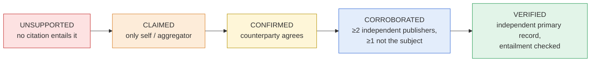
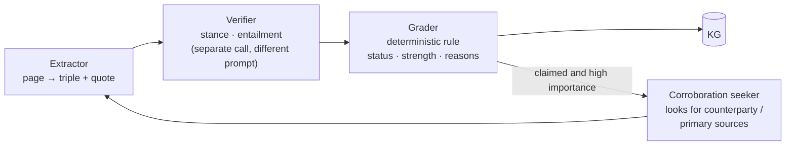

# Truth vs claim: evidence grading

> Every edge in the graph is a **claim**. How much we trust it depends on its citations: **who**
> says it, **how independent** they are, and **whether the quoted text actually supports it**.
> The Reasoner must *say* that strength in its wording, never turn a claim into a fact.

Spec for [`src/cf/graph/grading.py`](../src/cf/graph/grading.py). Weights are in
[`configs/evidence.yaml`](../configs/evidence.yaml) (proposed values, owner to confirm).

---

## 1. Why this matters here

Most of what the ecosystem says about itself is marketing. "#1 on APEX-Agents at up to 10.9×
lower cost" on a vendor's own page is a **self-claim**. It may be true, but nothing independent
has checked it yet. If the graph stores it as a fact, every answer built on it inherits the error.
And because PageRank sends importance along edges, a false edge also **misdirects the crawl**.

## 2. Three questions per citation

| Question | Field | Values | Set by |
|---|---|---|---|
| **Who** published it, relative to the claim? | `source_kind` | `self` · `counterparty` · `independent_primary` · `press` · `aggregator` | rule: publisher domain vs head/tail entity, plus the source registry |
| Does it **support, contradict or qualify** the claim? | `stance` | `supports` · `contradicts` · `qualifies` | Verifier agent (baseline: NLI model) |
| Does the quote **actually entail** the triple? | `entailed` | `true` · `false` · `null` (not yet checked) | Verifier agent, a **separate model call from the extractor** (maker/checker) |

`source_kind`, using the claim "Applied Compute —serves→ Harvey":

| Kind | Example | Why it counts differently |
|---|---|---|
| `self` | appliedcompute.com says it | the subject benefits from the claim |
| `counterparty` | harvey.ai says it | the other party confirms; harder to fake |
| `independent_primary` | the benchmark maintainer's leaderboard, a paper with results, a regulatory filing | a primary record not controlled by the subject |
| `press` | journalism or analyst piece | independent, but often repeats press releases |
| `aggregator` | directories, wikis, unknown sites | weakest |

**Independence counts publishers, not pages.** Five pages on appliedcompute.com count as one
publisher.

## 3. The status ladder



Two **flags** apply on top of any status:

- **CONTESTED**: a usable citation contradicts the claim. Both sides are kept, and strength is
  reduced.
- **STALE**: the newest supporting citation is older than `stale_after_days`. Strength is reduced,
  and answers say "as of <date>".

**Stricter rule for quantitative claims** ("#1 on X", "15× cheaper", "30% fewer errors"): press
coverage does **not** count toward corroboration, because it usually repeats the press release. A
quantitative claim reaches VERIFIED only through an independent primary record, such as the
leaderboard itself.

A citation the Verifier marks `entailed = false` is **dropped** and listed in the reasons. It is
never silently kept.

### 3.1 Asymmetric disclosure: silence is not evidence

Vendors advertise their customers. Customers rarely mention their vendors, because it's
competitive information or just not interesting to their readers. So:

- **Absence never lowers strength.** Only an explicit *contradicting* citation does. A
  vendor→customer edge with no word from the customer stays CLAIMED (0.5 for a relational claim),
  and it isn't treated as doubtful.
- **Absence is informative only where disclosure is expected.** Acquisitions, funding rounds and
  formal partnerships are usually announced by both sides; a missing confirmation there may be
  worth flagging. Vendor relationships are not.
- **Corroboration channels by relation.** The corroboration seeker looks where confirmation
  actually appears:

| Relation | Where the counterparty or a third party tends to confirm it |
|---|---|
| `serves` (vendor → customer) | joint press releases; customer job posts naming the tool; integration or docs pages; co-authored posts or talks; the customer's engineering blog |
| `uses_tech` / `builds_on` | GitHub dependencies, model cards, docs, papers' "we use" sections |
| `acquired` / `invests_in` | both parties' news pages, filings, investor portfolio pages |
| `measured_on` | the benchmark's own leaderboard (independent primary) |

- **Customer voice on a vendor page.** A testimonial quoting a *named person at the customer*
  ("— Jane Doe, CTO, Harvey") is the counterparty speaking, hosted by the vendor. Planned:
  the Extractor flags quotes attributed to a named customer person, and the grader treats them as
  between SELF and COUNTERPARTY.

## 4. Strength: one number for ranking and display

```
strength = status_strength[status] × (contested_factor if contested) × (stale_factor if stale)
```

Proposed values: unsupported 0 · confirmed 0.6 · corroborated 0.8 · verified 1.0 · contested
×0.5 · stale ×0.7.

**CLAIMED depends on how costly the claim is to fake** (not on how big the company is):

| Self-claim kind | Strength | Why |
|---|---|---|
| relational ("case study with Harvey") | 0.5 | naming a customer needs their consent; a false one gets called out |
| descriptive ("we use RL") | 0.5 | low stakes, usually true |
| event ("acquired Delegate") | 0.45 | public and checkable, but often announced before it closes |
| quantitative ("#1", "15× cheaper") | 0.3 | cheap to claim, costly to check; marketing's favourite |

**Page-genre conventions** (in the Verifier prompt) decide *what a page states*: a case-study title
naming Z on X's site states that X works with Z; "our research on Y" states that X works on Y. They
settle who did what. They never make numbers true.

**Later: learned publisher reliability.** Publishers whose self-claims keep getting confirmed by
counterparties or primary records earn a higher prior (truth discovery). Earned from track record,
never assumed from size.

- **Ranking:** edge weight in PPR push = `β[relation] × strength`. Weak claims pass less
  importance, so marketing can't steer the crawl (DESIGN.md §3).
- **Display:** a badge per edge plus the **reasons** list (e.g. "2 independent publishers",
  "quantitative: press not counted").
- **Calibration:** later, check on hand-graded edges whether higher strength really means "more
  often true" (reliability diagram), and fix the values from that.

## 5. How the Reasoner must speak (language contract)

| Status / flag | Allowed wording | Example |
|---|---|---|
| VERIFIED | plain statement + citation | "Mercor ranks #1 on APEX-Agents [leaderboard]." |
| CORROBORATED | "reported by A and B" | "Applied Compute serves Harvey (reported by both companies)." |
| CONFIRMED | "both parties say" / "B confirms" | "Harvey confirms working with Applied Compute." |
| CLAIMED | "X claims" / "according to X" | "Applied Compute *claims* a 15× cost advantage." |
| UNSUPPORTED | never used in answers | — |
| + CONTESTED | show both sides | "A says …; B disputes this …" |
| + STALE | "as of <date>" | "As of March 2025, …" |

An answer that states a CLAIMED edge as plain fact **fails** the eval, even if the claim later
turns out to be true.

## 6. Agent roles



The **corroboration seeker** is the agentic part. For high-PageRank edges that are only CLAIMED,
it searches for the counterparty's page, the leaderboard or the paper, and sends those pages back
through extraction. Verification effort is spent where the edge matters most.

## 7. How we test it

| Test | Metric | Baseline |
|---|---|---|
| Verifier entailment on about 200 labelled (quote, triple) pairs | accuracy, and false-support rate | NLI cross-encoder; "always true" |
| Grader on about 100 hand-graded edges | status agreement (Cohen's κ with the owner) | "everything claimed" |
| **Planted-claims stress test:** inject false or inflated claims on mock "self" pages | share that stay ≤ CLAIMED, and share the Reasoner states as fact | — |
| Reasoner wording | **epistemic faithfulness:** wording matches edge status | R0 no-graph |
| Calibration | reliability diagram of strength vs truth on audited edges | — |

## 8. Related work (from memory, unverified until read)

- **FEVER** (Thorne et al. 2018): claim verification against evidence, using supports / refutes /
  not-enough-info labels.
- **Truth discovery** (e.g. TruthFinder, Yin et al. 2008): estimating source reliability and
  fact truth together.
- **NATO Admiralty code:** grades source reliability (A–F) separately from the credibility of
  the information (1–6). This is the same split as our `source_kind` vs `stance`/`entailed`.
- **GRADE** (evidence grading in medicine): levels of evidence by study design. An analogy for
  the ladder.

What's known vs ours: claim verification and source reliability are established fields. Applying
them as a **graph-wide edge status that steers both crawling and answer wording** is our design
choice. The stress test is where it shows its value.
