# Scaling to hundreds of organisations

> Goal: go from a 1-seed scout to **hundreds of orgs**, keeping the same rank-guided crawl,
> curation and evidence checks, with cost, time and quality all measured.

Status: plan. Numbers below come from the 2026-11-21 scout (DECISIONS.md) and are indicative.

## 1. Where the time and money go today

| Stage | Per page (measured) | Share of cost |
|---|---|---|
| Fetch (polite, 2 s/host) | ~2 s | — |
| Extract (inkling-2-mini) | ~18 s · ~$0.002 | ~20% |
| **Verify (nemotron-3.5-lightning)** | **~95 s · ~$0.008** | **~80%** |

**Rough total ≈ $0.01 and ~2 min per page, run serially.** For 300 orgs × 12 pages = 3,600 pages:
about **$36** and about **5 days serially**. Cost is fine. Time and the verifier are the
bottlenecks.

## 2. Architecture at scale: idempotent stages over a queue

```mermaid
flowchart LR
    subgraph Discover
        SR["Seed registry<br/>~50 seeds across layers"] --> FR
        FR["Frontier<br/>PPR push over orgs"] --> DR["Domain resolver<br/>links · Wikidata · search"]
        DR --> SM["Source map<br/>sitemap.xml + URL-type rules"]
    end
    SM --> Q1[(fetch queue)]
    Q1 --> F["Fetch workers<br/>async, per-host politeness"] --> RAW[(raw cache<br/>by content hash)]
    RAW --> Q2[(extract queue)] --> X["Extract workers<br/>batch / concurrent LLM"]
    X --> Q3[(verify queue)] --> V["Tiered verify<br/>NLI → LLM only if unsure"]
    V --> DB[("SQLite (WAL)<br/>entities · edges · evidence")]
    DB --> ER["Entity resolution<br/>blocking + embeddings + LLM"] --> G["Grade + rank<br/>(incremental PPR push)"]
    G --> FR
    G --> QA["QA: sampled audits,<br/>stress tests, dashboards"]
```

**Design rules**

1. **Every stage is idempotent and keyed by content hash.** Re-runs skip work already done; an
   unchanged page is never re-extracted. A crash resumes from the queue, not from the start.
2. **The frontier is over organisations; pages are chosen per org.** PPR push decides *which org
   next*. A source map (sitemap.xml + URL rules: `/customers`, `/case-studies`, `/research`,
   `/careers`, `/blog`) decides *which pages*, with a bandit learning which page types pay off.
3. **Concurrency where it's safe:** many hosts in parallel (one request per host every 2 s), LLM
   calls through a semaphore (OpenRouter rate limits), batch-priced models for bulk extraction.
4. **Plain Python asyncio + SQLite.** No Kafka, no cluster. Move to Postgres only if SQLite's
   single writer becomes the bottleneck.

## 3. Cutting the verifier bottleneck (the main lever)

| Tactic | Effect | Risk / check |
|---|---|---|
| **Tiered verification:** cheap NLI cross-encoder first; LLM only for uncertain items | ~5–10× fewer LLM verify calls | NLI false-accept rate on the labelled set |
| **Verify by importance:** LLM-verify edges with high PPR or used in answers; leave the long tail "unchecked" | effort follows importance | unchecked edges stay visibly unchecked |
| **Batch per page** (already done) and run pages concurrently | wall-clock ÷ concurrency | rate limits |
| **A faster verifier model**, picked on the labelled set | — | must stay a different family from the extractor |

## 4. Entity resolution becomes the hard part

At hundreds of orgs, "Harvey" vs "Harvey AI" vs "harvey.ai", or "RL" vs "reinforcement learning",
decides whether PageRank means anything.

- **Orgs:** the domain is the key. Wikidata QIDs where they exist.
- **Methods, benchmarks, models:** a curated alias table plus embedding blocking plus LLM
  adjudication for unclear pairs; benchmark names checked against leaderboards.
- **Metric:** pairwise merge precision on the resolution gold set; false merges are worse than
  missed merges.

## 5. Quality control at scale

- **Stratified sampled audits:** each week, hand-check about 50 edges, sampled by layer × status.
  Gives precision with a confidence interval.
- **Stress test** (planted claims) on every extractor or verifier change.
- **Dashboards:** verifier reject rate per publisher and per relation; unquoted-drop rate;
  entity-merge rate; cost per new valid edge; coverage estimate (capture–recapture).
- **Drift:** recrawl cadence by page change rate; diff snapshots.

## 6. Rollout ladder (each rung ends with numbers)

| Rung | Scope | What must hold before the next |
|---|---|---|
| R0 | 1 seed (scout) | pipeline runs; failure modes logged ✅ in progress |
| R1 | 3 seeds, 50 orgs | SQLite store, resumable queue, async fetch; gold sets frozen; BFS vs PPR at 500 fetches |
| R2 | 10 seeds, ~150 orgs | tiered verify; ER on embeddings; weekly audit P ≥ 0.85 |
| R3 | ~50 seeds, 300–500 orgs | cost ≤ $0.01 per valid edge; coverage estimate per layer; first HF snapshot |

## 7. What only the owner can supply

- The **seed registry**: about 50 orgs across layers. It encodes judgment about relevance.
- The **gold sets** for audit and evaluation.
- The **budget** per rung.
